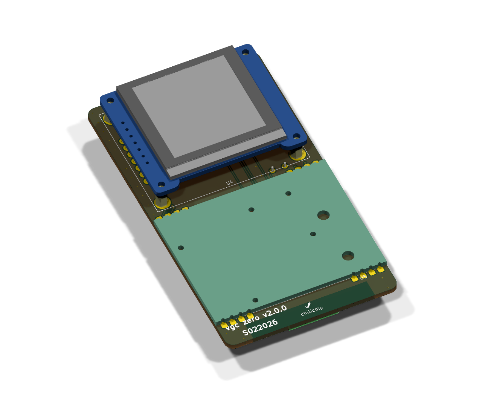
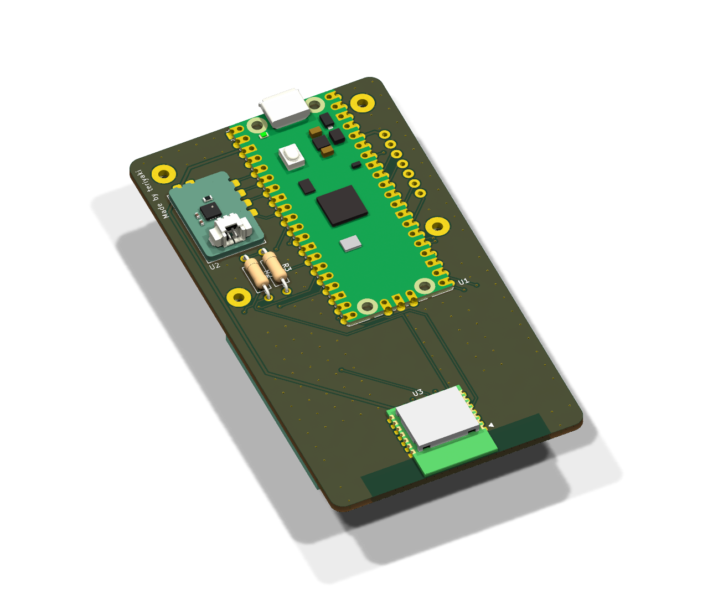
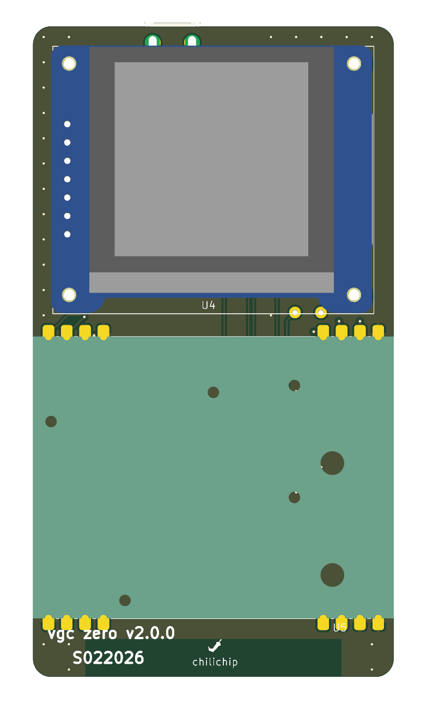
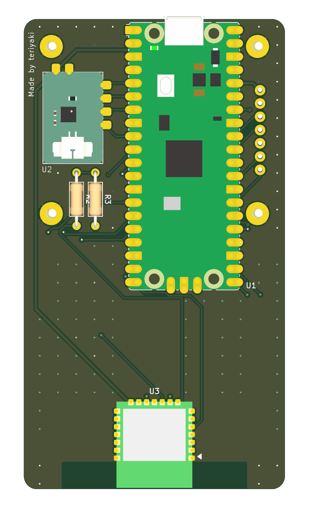

# chilichip console hardware (VGC Zero)

KiCad 10 project for the main board of [chilichip](https://chilichip.eu)'s open hardware keychain game console, the **VGC Zero**. A Raspberry Pi Pico 2 runs the console; the display, buttons, audio and Wi-Fi/Bluetooth are modules that solder or plug onto this board. Firmware and games are built with the [chili-chip 32blit SDK](https://github.com/chili-chip/32blit-sdk) (board `chilichip_vgc`).

Current revision: **v2.0.0**. The schematic (`vgc-zero.kicad_sch`) is the source of truth for everything below.

  
  

| Front | Back |
|:---:|:---:|
|  |  |

## Specifications

| | |
|---|---|
| Board | 50 × 90 mm, 2 layers, 1.6 mm, GND pour on both layers |
| MCU | Raspberry Pi Pico 2 (RP2350), soldered flat on the back by its castellated edge |
| Display | Waveshare 1.5" RGB OLED (SSD1351, 128 × 128, SPI) on the front |
| Buttons | [chili-buttons-module](https://github.com/chili-chip/chili-buttons-module-hardware): D-pad, A/B, X/Y, Start/Select, soldered flat on the front |
| Audio | [chili-audio-module](https://github.com/chili-chip/chili-audio-module-hardware): MAX98357A I²S class D amplifier, soldered flat on the back |
| Wireless | Raspberry Pi Radio Module 2 (RM2, CYW43439): Wi-Fi 4 and Bluetooth 5.2, on the back with its antenna at the bottom edge over a copper keep-out |
| Power | USB on the Pico; the Pico's 3.3 V output supplies all modules |

## Parts

| Ref | Part | Side | Notes |
|-----|------|------|-------|
| U1 | [Raspberry Pi Pico 2](https://www.raspberrypi.com/products/raspberry-pi-pico-2/) | back | `Module:RaspberryPi_Pico_SMD_HandSolder`, including the SWD debug pads |
| U2 | [chili-audio-module](https://github.com/chili-chip/chili-audio-module-hardware) v1.1+ | back | castellated, 11.5 × 17.5 mm |
| U3 | [Raspberry Pi Radio Module 2](https://www.raspberrypi.com/products/radio-module-2/) | back | `RF_Module:RMC20452T` |
| U4 | [Waveshare 1.5inch RGB OLED Module](https://www.waveshare.com/wiki/1.5inch_RGB_OLED_Module) | front | 7-pin 2.54 mm header plus four mounting holes |
| U5 | [chili-buttons-module](https://github.com/chili-chip/chili-buttons-module-hardware) v1.2+ | front | castellated, 50 × 39 mm |
| R2 | 470 Ω, axial | back | RM2 DO to the shared data line |
| R3 | 10 kΩ, axial | back | RM2 nIRQ to the shared data line |

The RM2 is wired like the Pico W radio: one GPIO (WIFI_DIO) drives DI directly and reads DO and nIRQ through R2 and R3.

## Pin map

GPIOs were chosen so every trace runs as short and straight as possible to its module. The display sits on hardware SPI1, and the Wi-Fi signals sit on SPI1's SCK/TX/CSn pins; the RM2's driver (cyw43) runs it from PIO.

| GPIO | Pico pin | Signal | Notes |
|------|----------|--------|-------|
| GP3 | 5 | AUDIO_DIN | I²S data |
| GP4 | 6 | AUDIO_BCLK | I²S bit clock |
| GP5 | 7 | AUDIO_LRCLK | I²S word select (BCLK + 1, as the PIO I²S driver expects) |
| GP6 | 9 | AUDIO_MODE | amplifier enable (high = on, mono mix) |
| GP7 | 10 | BTN_A | |
| GP8 | 11 | BTN_B | |
| GP9 | 12 | WIFI_ON | RM2 WL_ON and BT_ON |
| GP10 | 14 | BTN_Y | |
| GP11 | 15 | BTN_X | |
| GP12 | 16 | BTN_SELECT | |
| GP13 | 17 | WIFI_CS | SPI1 CSn |
| GP14 | 19 | WIFI_CLK | SPI1 SCK |
| GP15 | 20 | WIFI_DIO | SPI1 TX; DI direct, DO via R2, nIRQ via R3 |
| GP16 | 21 | BTN_DOWN | |
| GP17 | 22 | BTN_RIGHT | |
| GP18 | 24 | BTN_START | |
| GP19 | 25 | BTN_UP | |
| GP20 | 26 | BTN_LEFT | |
| GP21 | 27 | DISP_RST | |
| GP22 | 29 | DISP_DC | |
| GP26 | 31 | DISP_CLK | SPI1 SCK |
| GP27 | 32 | DISP_DIN | SPI1 TX |
| GP28 | 34 | DISP_CS | |

GP0–GP2 are free (GP0/GP1 suit UART0 for debugging). Buttons short to GND when pressed and have no pull-ups on the module, so enable the RP2350's internal pull-ups.

## Ordering the PCB from JLCPCB

Every tagged release has `chilichip-console-<version>-gerbers.zip` (Gerbers and drill) and `chilichip-console-<version>-bom.csv` (hand-assembly BOM) attached.

1. Download the gerber zip from the [latest release](https://github.com/chili-chip/vgc-zero-hardware/releases/latest).
2. On [jlcpcb.com](https://jlcpcb.com/), click **Order now** and upload the zip.
3. Choose 2 layers and 1.6 mm thickness. HASL is fine; ENIG is nicer for soldering the castellated modules flat. Everything else can stay at the defaults.
4. Leave **PCB Assembly** off: every part on this board is soldered by hand.

The audio and buttons modules are separate boards. Order them from their own repositories.

To build the files from a local checkout instead, run `scripts/export-jlcpcb.sh` (needs KiCad 10's `kicad-cli` and `zip`). They're written to `production/`.

## Assembly

1. **Back side:** solder the Pico 2 flat by its castellations, then the RM2, the audio module, and R2/R3.
2. **Front side:** solder the buttons module flat by its castellations, then fit the display on its 7-pin header and fix it with the four mounting holes.
3. Keep the area past the RM2's antenna clear: no metal, cables or fingers over the keep-out at the bottom edge.

## Repository layout

| Path | Contents |
|------|----------|
| `vgc-zero.kicad_*` | KiCad 10 schematic, PCB and project |
| `vgc-zero-symbols.kicad_sym`, `vgc-zero-footprints.pretty/` | Project symbols and footprints (module outlines and castellation lands) |
| `RPI_RMC20452T.kicad_sym` | Official RM2 symbol from Raspberry Pi |
| `3d-models/` | STEP models of the modules (display, audio, buttons, RM2) |
| `vgc-zero.glb` | 3D export of the assembled board |
| `scripts/export-jlcpcb.sh` | Builds the gerber zip and BOM |
| `scripts/render-images.sh` | Regenerates the renders in `docs/images/` and `vgc-zero.glb` |
| `docs/next-revision.md` | The plan this revision implemented |
| `.github/workflows/main.yml` | CI and release workflow |

CI runs ERC, DRC and the JLCPCB export on every push and pull request. Pushing a `v*` tag publishes a GitHub release with the schematic PDF, a PCB image, Gerbers and the JLCPCB files.

## Earlier revisions

Board v1.1.4 used a Waveshare RP2350-Plus, ten through-hole tactile buttons, a buzzer, an LED and a JST cable to the display. The first prototype was built on a breadboard: see the [breadboard guide](https://chilichip.eu/docs/vgc-zero/vgc-breadboard/).

## License

MIT, see [LICENSE](LICENSE).
