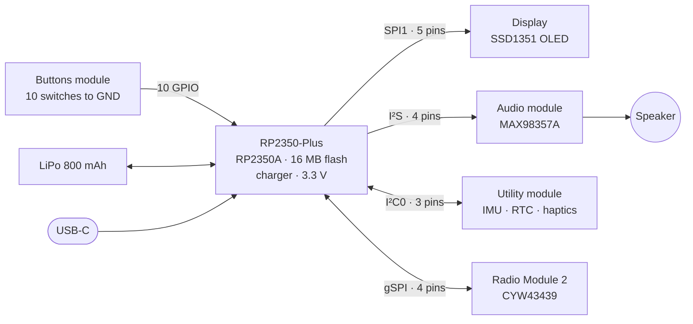
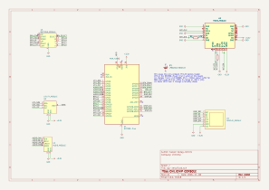

# Architecture

The RP2350 talks to each part of the console over one bus. Each bus goes to one module, so the traces stay short and no two modules share pins, except the I²C bus inside the utility module.

## Block diagram

The [power](power.md) page has the power tree.

## Buses

| Bus | Peripheral | RP2350 block | GPIOs | Speed | Module |
|---|---|---|---|---|---|
| SPI (write only) | SSD1351 display | SPI1 (or PIO) | GP26 CLK, GP27 DIN, GP28 CS, GP22 DC, GP21 RST | 20 MHz | [Display](../modules/display.md) |
| I²S | MAX98357A amplifier | PIO | GP3 DIN, GP4 BCLK, GP5 LRCLK, GP6 MODE | 44.1 kHz in the SDK's I²S driver | [Audio](../modules/audio.md) |
| I²C | IMU, RTC, haptic driver | I2C0 | GP0 SDA, GP1 SCL, GP2 INT | Up to 400 kHz (fast mode) | [Utility](../modules/utility.md) |
| gSPI | CYW43439 radio | PIO (`cyw43` driver) | GP9 ON, GP13 CS, GP14 CLK, GP15 DIO | Set by the driver | [Radio](../modules/radio.md) |
| GPIO | 10 buttons | SIO | GP7, GP8, GP10 to GP12, GP16 to GP20 | | [Buttons](../modules/buttons.md) |
| ADC | Battery voltage | ADC3 | GP29 (inside the RP2350-Plus) | | [Brain](../modules/brain.md) |

Two notes on the choices:

- **Display and radio both sit on SPI1's pins.** The display uses SPI1 at GP26/GP27. The radio's pins GP13 to GP15 are SPI1's CSn, SCK and TX on the other bank, but the radio runs from PIO, so the two never fight over SPI1.
- **I²S LRCLK must be BCLK + 1.** The PIO I²S program side-sets both clocks from one base pin. GP4 and GP5 meet that.

The firmware sets the real clock speeds; see [firmware and software](firmware.md).

## Shared lines

| Line | Shared by | How |
|---|---|---|
| UTIL_INT (GP2) | IMU INT1, RTC ~INT | Open drain, 10 kΩ pull-up on the utility module. The IMU must be set to open drain first |
| WIFI_DIO (GP15) | RM2 DI, DO and nIRQ | DI is direct, DO through R2 (470 Ω), nIRQ through R3 (10 kΩ). Same as the Pico W |
| GND | Everything | Copper pour on both layers |

## Schematic

The main board fits on one A4 sheet. The modules are drawn as blocks with their pins; their own schematics are on the [module pages](../modules/index.md).

<figure markdown>
[{ .drawing loading=lazy }](../schematics/main-board.svg)
<figcaption>Main board v3.0.0. Click to open it full size. A PDF is attached to the <a href="https://github.com/chili-chip/vgc-zero-hardware/releases/tag/v3.0.0">release</a>.</figcaption>
</figure>

## Why modules

The console is split into modules on purpose.

| Reason | What it means |
|---|---|
| Hand soldering | The main board has no fine-pitch parts. Anyone with a soldering iron can build it |
| Factory assembly where it counts | The tiny QFN and LGA chips are on modules that JLCPCB assembles |
| Reuse | Each module works on other boards too. The audio module works with any 3.3 V I²S source |
| Repair and upgrades | A new display or radio only needs a new module or a new main board, not a new everything |

The [modules](../modules/index.md) section covers each one.
