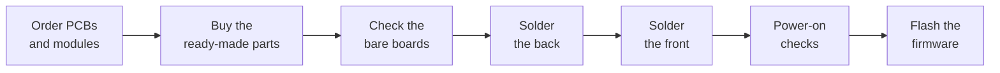

# Order and build

This page takes you from the release files to a working console. You need a fine-tip soldering iron, flux, solder wick, a multimeter and some patience with castellated pads.

## 1. Order the boards

Order all four boards from [JLCPCB](https://jlcpcb.com/). Each repository attaches its files to every release.

| Board | Download | PCB options | Assembly |
|---|---|---|---|
| Main board | `chilichip-console-v3.0.0-gerbers.zip` from the [release](https://github.com/chili-chip/vgc-zero-hardware/releases/tag/v3.0.0) | 2 layers, 1.6 mm. HASL is fine, ENIG is nicer | Off |
| Audio module | Gerbers, BOM and CPL from the [release](https://github.com/chili-chip/chili-audio-module-hardware/releases/latest) | Castellated holes: Yes, ENIG recommended | Top side |
| Utility module | Gerbers, BOM and CPL from the [release](https://github.com/chili-chip/chili-utility-module-hardware/releases/latest) | Castellated holes: Yes | Top side, motor by global sourcing |
| Buttons module | Gerbers from the repository (v1.2.0 is not released yet; see [buttons](../modules/buttons.md#versions)) | Castellated holes: Yes, **ENIG required** | Off |

For the main board:

1. Download the gerber zip from the release.
2. On jlcpcb.com, click **Order now** and upload the zip.
3. Choose 2 layers and 1.6 mm. Leave everything else at the defaults.
4. Leave **PCB Assembly** off. Every part on the main board is soldered by hand.

The module pages have step-by-step ordering guides, including what to check in JLCPCB's placement preview.

## 2. Buy the ready-made parts

See the [parts list](parts.md): the RP2350-Plus (16 MB), the display, the Radio Module 2, the battery, a speaker, two resistors and the rubber button pads.

## 3. Check the bare boards

Before you solder anything:

- [ ] Look at every castellated edge on the modules. The half-holes should be clean and plated.
- [ ] Check the buttons module is ENIG (gold). HASL contacts will not work with carbon pads.
- [ ] On the audio and utility modules, check pin 1 of every chip against the silkscreen.

## 4. Solder the back

Solder the low, flat parts first, then the tall ones.

| Step | Part | Tip |
|---|---|---|
| 1 | U1 RP2350-Plus | Line it up with the outline, tack two opposite corners, check alignment, then solder every castellation. The footprint has clearance holes for the USB-C shell legs |
| 2 | U3 Radio Module 2 | Antenna towards the bottom edge, over the area with no copper |
| 3 | U2 audio module | Speaker connector J3 facing the top edge |
| 4 | U6 utility module | Six lands on one edge. Keep the motor end clear of the battery |
| 5 | R2 (470 Ω), R3 (10 kΩ) | Axial, lying flat |

Do not fit the battery yet.

## 5. Solder the front

| Step | Part | Tip |
|---|---|---|
| 1 | U5 buttons module | Solder it flat by its 16 castellations. Keep flux off the gold button contacts and clean them with isopropyl alcohol afterwards |
| 2 | U4 display | Fit its 7-pin header through the board, add the standoffs and screws, then solder the header from the back |

## 6. Power-on checks

With USB unplugged and no battery:

- [ ] Measure between 3V3 and GND. It must not be a short (more than a few hundred ohms).
- [ ] Measure between VSYS and GND. Not a short either.

Plug in USB only:

- [ ] 3V3 reads 3.3 V.
- [ ] The RP2350-Plus LED and power LED behave as on a bare RP2350-Plus.
- [ ] Nothing gets warm.

Then unplug USB, check the battery plug polarity, plug in the battery and tape it down inside its outline.

## 7. Flash the firmware

Firmware is flashed over USB in the RP2350's BOOTSEL mode. On v3.0.0, hold the **BOOT** button on the RP2350-Plus and press **RESET**, or hold BOOT while you plug in USB. The console shows up as a USB drive called `RP2350`; copy a `.uf2` file onto it.

The full guide is in the console SDK docs: [Flashing and the loader](https://sdk.chilichip.eu/console/flashing/).

!!! warning "Firmware for v3.0.0 is not ready yet"
    The console firmware still targets board v1.1.4. On v3.0.0 the display, buttons and sound use different pins, so the current firmware will not show a picture or play sound. See [firmware and software](firmware.md).

## Troubleshooting

| Symptom | Check |
|---|---|
| No USB drive in BOOTSEL mode | USB-C cable carries data; U1 castellations near the USB end are soldered |
| Blank display | 7-pin header joints; the firmware's display pins match the [pin map](pin-map.md) |
| A button does nothing | Contacts are clean and gold; its castellation is soldered; the GPIO has its pull-up enabled |
| No sound | Speaker plugged into J3; AUDIO_MODE is driven high; the amplifier's six castellations are soldered |
| No Wi-Fi | R2 and R3 are fitted; nothing metal near the antenna |
| Utility module not found on I²C | Scan I2C0 on GP0/GP1 for 0x6A, 0x52 and 0x5A; check its six lands |
