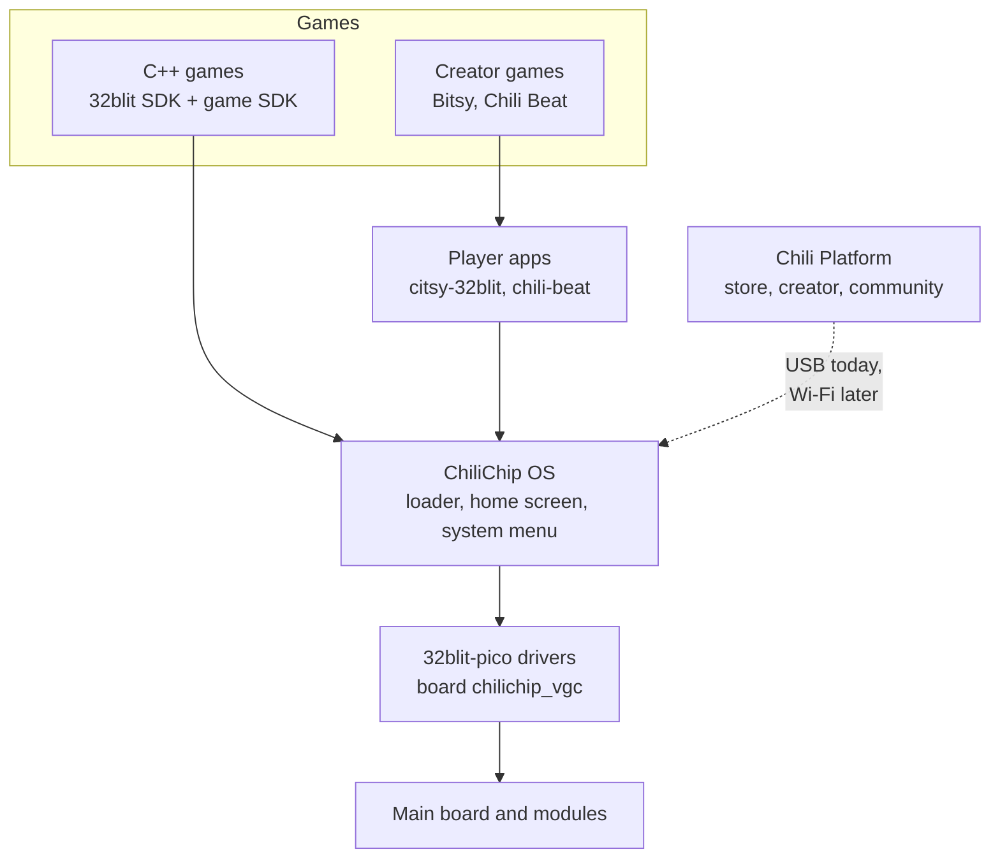

# Firmware and software

The console runs **ChiliChip OS**, built from the [console SDK](https://sdk.chilichip.eu) (chili-chip's fork of the 32blit SDK) for the board `chilichip_vgc`. Games are 32blit `.blit` files. Games made in the [creator](https://creator.chilichip.eu) run through a player app on the console.

This page lists what the hardware needs from the firmware, and where the firmware does not match main board v3.0.0 yet.

## Software stack

| Layer | Repository | Docs |
|---|---|---|
| Board files and drivers | [32blit-sdk](https://github.com/chili-chip/32blit-sdk), `32blit-pico/board/chilichip_vgc*` | [sdk.chilichip.eu](https://sdk.chilichip.eu/console/) |
| Game SDK | [chili-game-sdk](https://github.com/chili-chip/chili-game-sdk) | [game-sdk.chilichip.eu](https://game-sdk.chilichip.eu) |
| Bitsy player | [citsy-32blit](https://github.com/chili-chip/citsy-32blit) | |
| Firmware tool | [chilichip-cli](https://github.com/chili-chip/chilichip-cli) | |

## What the hardware needs from the firmware

| Part | Driver the board needs | In the SDK today |
|---|---|---|
| Display | SSD1351 over SPI, 20 MHz | Yes: `dbi_ssd1351` |
| Buttons | GPIO with internal pull-ups, active low | Yes: `input gpio` |
| Sound | I²S over PIO, plus AUDIO_MODE high to enable the amplifier | Driver exists (`audio i2s`), not used by `chilichip_vgc` yet |
| Battery level | ADC on GP29, divider 3, +300 mV | Yes |
| IMU | LSM6DS3TR-C on I2C0, INT1 set to open drain | No. `tilt` reads zero |
| RTC | RV-3028-C7 on I2C0, backup switchover on (`BSM = 11`) | No |
| Haptics | DRV2605L on I2C0, ERM mode, auto-calibration | No |
| Wi-Fi and Bluetooth | `cyw43` on PIO, pins GP9/GP13/GP14/GP15 | No, tracked in [32blit-sdk #64](https://github.com/chili-chip/32blit-sdk/issues/64) |
| Power off | Sleep every module, then RP2350 dormant | No |

The [utility module](../modules/utility.md#firmware-setup) page lists the register settings the IMU, RTC and haptic driver need.

## Pin map differences

The `chilichip_vgc` board files still describe **board v1.1.4**. Main board v3.0.0 moved almost every signal. Firmware for v3.0.0 needs these changes:

| Signal | v1.1.4 (firmware today) | v3.0.0 (this board) |
|---|---|---|
| Display SCK / MOSI | GP18 / GP19 (SPI0) | GP26 / GP27 (SPI1) |
| Display CS / DC / RST | GP17 / GP21 / GP20 | GP28 / GP22 / GP21 |
| Sound | PWM on GP22 | I²S: DIN GP3, BCLK GP4, LRCLK GP5, enable GP6 |
| D-pad up / down / left / right | GP9 / GP8 / GP10 / GP7 | GP19 / GP16 / GP20 / GP17 |
| A / B / X / Y | GP3 / GP5 / GP6 / GP4 | GP7 / GP8 / GP11 / GP10 |
| MENU / HOME | GP11 / GP2 | No such buttons; Start GP18, Select GP12 |
| LED | GP16 | None on the main board |
| Default I²C | I2C1 on GP14 / GP15 | I2C0 on GP0 / GP1 |
| Default UART | UART0 on GP0 / GP1 | Taken by I²C; use USB serial |
| BOOTSEL | Hold X while switching on | BOOT button on the RP2350-Plus |

Both boards can be supported side by side with two board names. Tracked in [32blit-sdk #63](https://github.com/chili-chip/32blit-sdk/issues/63).

## Buttons

32blit games know the buttons D-pad, A, B, X, Y, MENU and HOME. ChiliChip OS uses HOME for its system menu. Main board v3.0.0 has Start and Select instead of MENU and HOME, so the firmware must map them. The mapping is not decided yet.

| v3.0.0 button | Could map to | Effect |
|---|---|---|
| Start | MENU | Games keep their pause menu on MENU |
| Select | HOME | Short press opens the system menu, hold quits to home |

## Platform and creator

The hardware does not change how games get onto the console:

- **USB:** the console shows a USB drive. Copy `.blit` files onto it, or use `32blit install` or the chilichip CLI.
- **Platform:** games bought on [Chili Platform](https://platform.chilichip.eu) download as `.blit` files and go on over USB. Downloading over Wi-Fi needs the radio driver ([32blit-sdk #65](https://github.com/chili-chip/32blit-sdk/issues/65)).
- **Creator games** run in the Bitsy player (citsy-32blit) and the Chili Beat player, which ship in the factory image.

A game that uses only the screen, buttons and sound runs the same on v1.1.4 and v3.0.0 once the board files are updated. Games that want tilt, the clock or rumble need the new drivers first.
