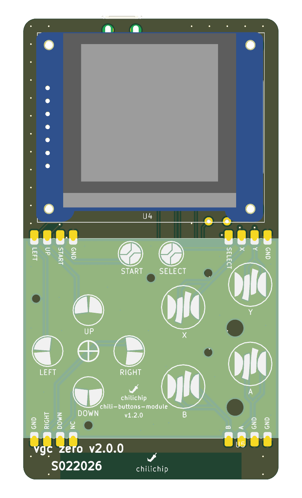
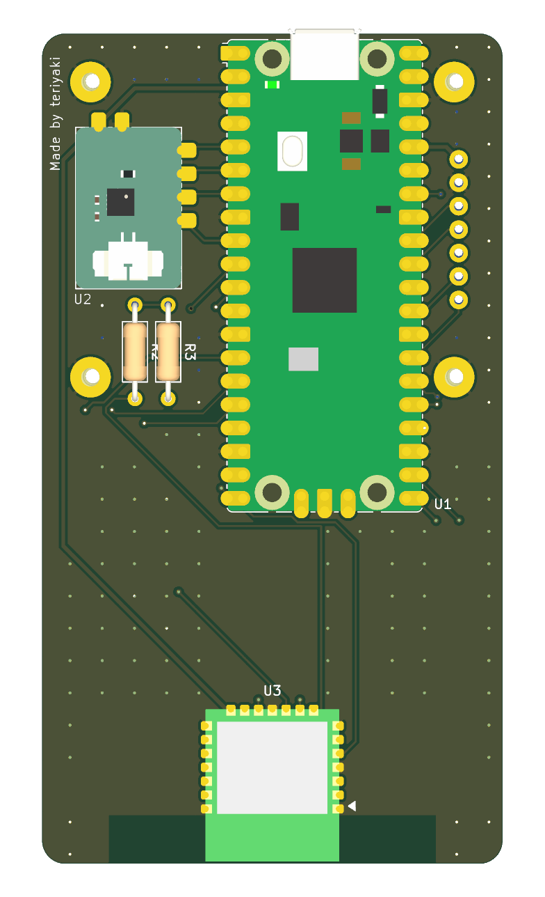

# The console

The console is built around one carrier board, the **main board**. Everything else is soldered or plugged onto it.

| Side | What sits there |
|---|---|
| Front | The display on a 7-pin header and four standoffs, then the buttons module, soldered flat |
| Back | The RP2350-Plus processor board, the audio module, the utility module, the radio module, two resistors and the LiPo |

<figure markdown>
{ .render loading=lazy }
<figcaption>Front</figcaption>
</figure>
<figure markdown>
{ .render loading=lazy }
<figcaption>Back</figcaption>
</figure>

The main board itself has no chips. It has copper, two resistors and the pads the modules solder to. That keeps it cheap and easy to order: a bare 2-layer PCB.

## Pages in this section

| Page | What you find there |
|---|---|
| [Specifications](specifications.md) | Every number in one table |
| [Architecture](architecture.md) | Block diagram, buses and the schematic |
| [Pin map](pin-map.md) | Every RP2350 GPIO and what it does |
| [Power](power.md) | Battery, charging, power rails and current draw |
| [Mechanical](mechanical.md) | Size, thickness, placement drawings and the shell |
| [Parts list](parts.md) | What to buy and where |
| [Order and build](build.md) | Order the PCBs and solder a console |
| [Firmware and software](firmware.md) | What the board needs from the firmware, and what is still missing |
