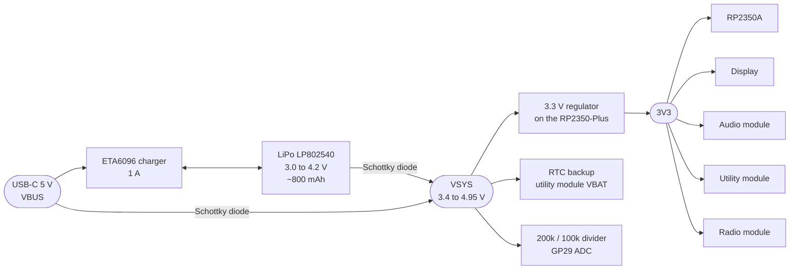

# Power

The console runs from a single LiPo cell. The RP2350-Plus charges it from USB-C and makes the 3.3 V rail for the whole console. The main board has no power parts of its own.

## Power tree



All parts of the charger, the diodes and the regulator are on the [RP2350-Plus](../modules/brain.md). The main board only routes 3V3, VSYS and GND to the modules.

## Battery

| | |
|---|---|
| Cell | LP802540 LiPo, 1 cell, 3.7 V nominal, about 800 mAh |
| Size | 8.0 × 25 × 40 mm |
| Protection | Protection board (PCM) on the cell |
| Plug | PH1.25 2-pin, into the RP2350-Plus battery header |
| Fixing | Double-sided tape inside the LiPo outline on the back |

!!! warning "Check the plug polarity"
    PH1.25 battery leads are not wired the same way by every seller. Check red goes to + on the RP2350-Plus before you plug the cell in. A reversed cell can destroy the charger.

## Charging

| | |
|---|---|
| Charger | ETA6096 on the RP2350-Plus |
| Current | 1 A, set by R13 = 160 kΩ on the RP2350-Plus |
| For this cell | 1 A is about 1.25C for an 800 mAh cell, a bit above the usual 1C |
| Gentler option | Replace R13 with about 200 kΩ to charge at about 0.8 A (1C) |
| Time | Roughly 1 to 1.5 hours from empty (estimate, not measured) |

## Battery level

GP29 reads VSYS through a 200k / 100k divider on the RP2350-Plus, so the ADC sees one third of VSYS. VSYS is the battery voltage minus the drop of a Schottky diode (about 0.3 V). The console SDK adds the drop back:

```c
// 32blit-sdk: 32blit-pico/board/chilichip_vgc/config.h
#define BATTERY_ADC_PIN 29
#define BATTERY_DIVIDER 3.0f
#define BATTERY_OFFSET_MV 300
```

While USB is plugged in, VSYS follows VBUS, so the reading shows USB power, not the battery.

## Current draw

These are datasheet figures for each load. The whole console has not been measured yet.

| Load | Rail | Typical draw | Can be turned off by |
|---|---|---|---|
| RP2350A and flash | 3V3 | Tens of mA, depending on clock speed | Sleep and dormant modes |
| Display (SSD1351 OLED) | 3V3 | Depends on how many pixels are lit and how bright | Display sleep command |
| Audio (MAX98357A) | 3V3 | 2.4 mA quiescent, more while playing | AUDIO_MODE low (0.6 µA) |
| IMU (LSM6DS3TR-C) | 3V3 | About 1 mA with both sensors on | Power-down mode over I²C |
| RTC (RV-3028-C7) | VSYS (backup) | 45 nA | Always on |
| Haptic driver and motor | 3V3 | About 77 mA while the motor runs (100 mA max) | Driver standby over I²C |
| Radio (RM2) | 3V3 | Up to a few hundred mA in short bursts while sending | WIFI_ON low |

Battery life is not measured yet. To measure it, run a game with the screen at normal brightness and the radio off, from a full charge, and note the time to shutdown.

## Turning the console off

Main board v3.0.0 has **no power switch**. The LiPo stays connected to the RP2350-Plus all the time. That has three effects:

1. "Off" is a firmware state. The firmware must put the display, amplifier, IMU, haptic driver and radio to sleep and then put the RP2350 into its lowest-power mode.
2. The regulator and the rest of the RP2350-Plus still draw a small current, so a console left "off" for weeks will drain its battery.
3. The RTC keeps time, because it runs from VSYS.

Unplug the battery for storage or shipping.

Board v1.1.4 had a hard power switch. See [revisions](../revisions.md).
