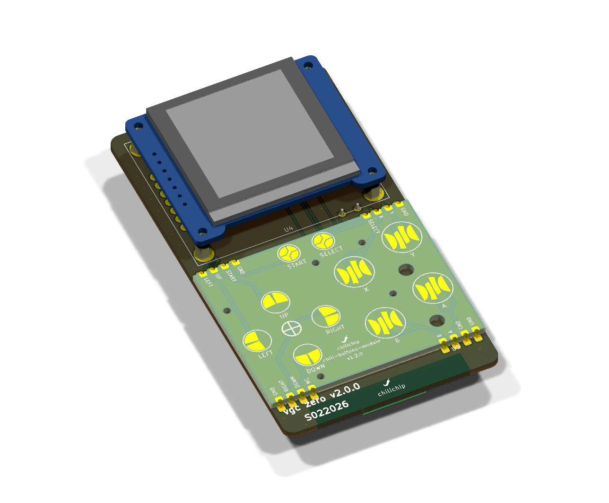
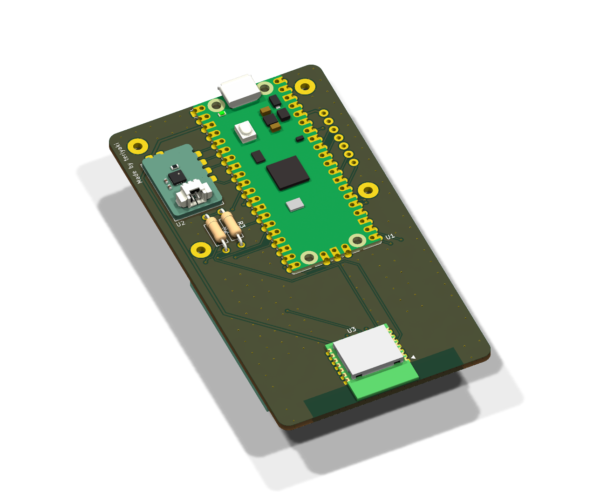
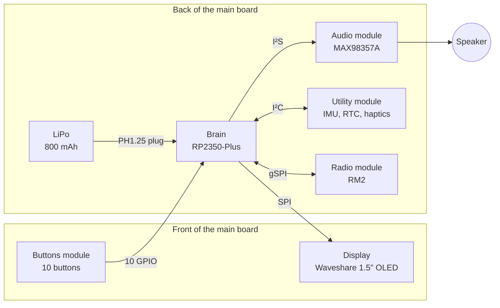

---
hide:
  - navigation
---

# chilichip console hardware

The **chilichip console** is a pocket game console you build yourself. It is open hardware: every board is a KiCad 10 project on GitHub, under the MIT licence.

The console is a set of small boards. A main board carries the processor board, the screen, the buttons and four small modules. Each module is a tiny board with castellated edges. It is assembled at the factory, and you solder it flat onto the main board by hand.

<figure markdown>
{ .render loading=lazy }
<figcaption>Front: display and buttons</figcaption>
</figure>
<figure markdown>
{ .render loading=lazy }
<figcaption>Back: processor, battery, audio, utility and radio</figcaption>
</figure>

!!! info "Which version these pages describe"
    These pages describe **main board v3.0.0**, the [latest release](https://github.com/chili-chip/vgc-zero-hardware/releases/tag/v3.0.0) of this repository (6 November 2026). Older boards are on the [revisions page](revisions.md). Designs that are not released yet are marked **work in progress**.

    The board's code name is VGC Zero. You still see it in file names, tags and the repository name.

## At a glance

| | |
|---|---|
| Processor | Raspberry Pi RP2350A, 2 × Arm Cortex-M33, 520 KB RAM, 16 MB flash ([Waveshare RP2350-Plus](modules/brain.md)) |
| Screen | 1.5" colour OLED, 128 × 128 pixels, 65k colours ([display](modules/display.md)) |
| Controls | D-pad, A, B, X, Y, Start, Select ([buttons module](modules/buttons.md)) |
| Sound | I²S class D amplifier, mono speaker ([audio module](modules/audio.md)) |
| Sensors | 6-axis motion sensor, real-time clock, vibration motor ([utility module](modules/utility.md)) |
| Wireless | Wi-Fi 4 and Bluetooth 5.2 ([Raspberry Pi Radio Module 2](modules/radio.md)) |
| Power | 800 mAh LiPo, charged over USB-C ([power](console/power.md)) |
| Size | 50 × 100 mm board, about 19 mm thick ([mechanical](console/mechanical.md)) |

The full list is on the [specifications](console/specifications.md) page.

## How the boards fit together

## Repositories

| Board | Repository | Latest release | Used on main board v3.0.0 |
|---|---|---|---|
| Main board | [vgc-zero-hardware](https://github.com/chili-chip/vgc-zero-hardware) | [v3.0.0](https://github.com/chili-chip/vgc-zero-hardware/releases/tag/v3.0.0) | |
| Buttons module | [chili-buttons-module-hardware](https://github.com/chili-chip/chili-buttons-module-hardware) | [v1.1.0](https://github.com/chili-chip/chili-buttons-module-hardware/releases/tag/v1.1.0) | v1.2.0 (not tagged yet) |
| Audio module | [chili-audio-module-hardware](https://github.com/chili-chip/chili-audio-module-hardware) | [v1.1.1](https://github.com/chili-chip/chili-audio-module-hardware/releases/tag/v1.1.1) | v1.1 or later |
| Utility module | [chili-utility-module-hardware](https://github.com/chili-chip/chili-utility-module-hardware) | [v2.0.0](https://github.com/chili-chip/chili-utility-module-hardware/releases/tag/v2.0.0) | v2.0 or later |

The display, the processor board and the radio module are bought ready-made.

## Where to go next

- **[Specifications](console/specifications.md)**: every number in one place.
- **[Pin map](console/pin-map.md)**: which GPIO goes where.
- **[Order and build](console/build.md)**: order the boards and solder a console.
- **[Modules](modules/index.md)**: one page per module, with pinouts and parts.
- **[Firmware and software](console/firmware.md)**: what runs on the console and what the board needs from it.
- **[Revisions and roadmap](revisions.md)**: earlier boards and what comes next.

## Related sites

| Site | What it is |
|---|---|
| [chilichip.eu](https://chilichip.eu) | Website and blog |
| [platform.chilichip.eu](https://platform.chilichip.eu) | Chili Platform: buy the console, get games, make games in the creator |
| [sdk.chilichip.eu](https://sdk.chilichip.eu) | Console SDK: make games in C++, flash the firmware |
| [game-sdk.chilichip.eu](https://game-sdk.chilichip.eu) | Game SDK: menus, scenes and saves for console games |
| [creator.chilichip.eu](https://creator.chilichip.eu) | Creator docs: make games without code |
