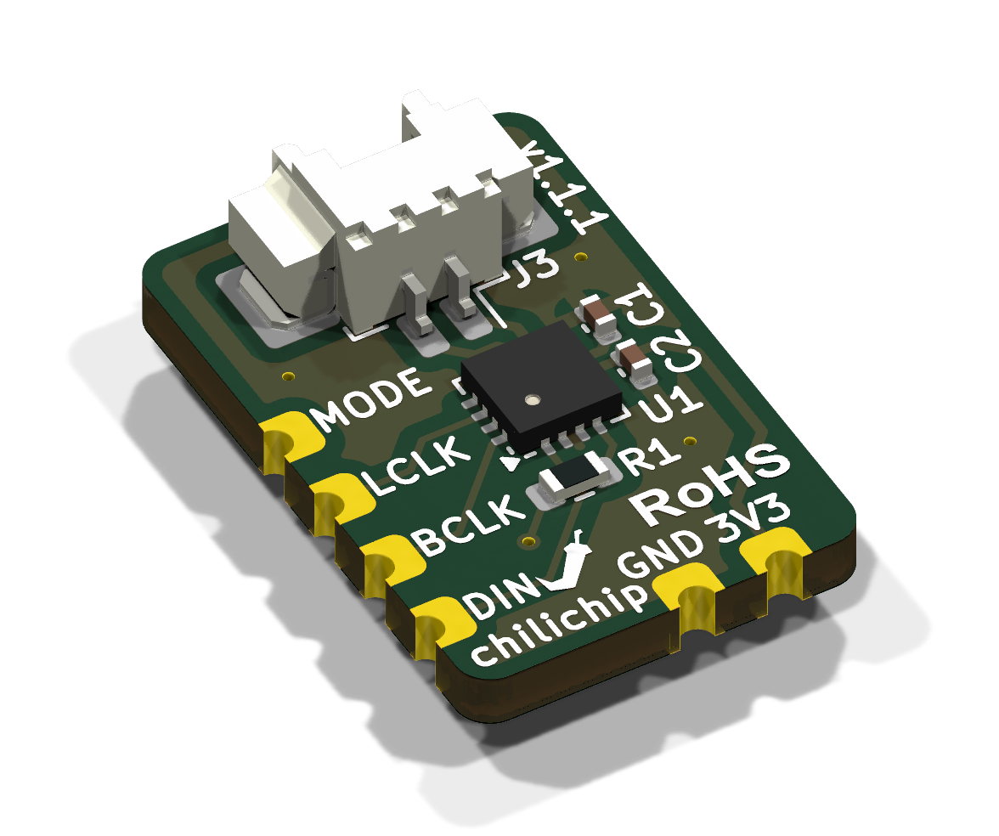
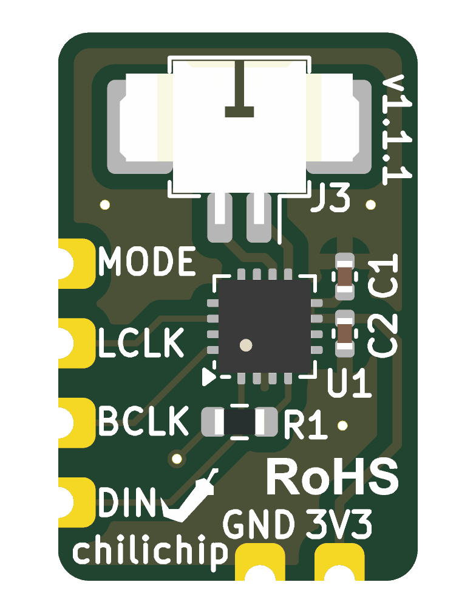
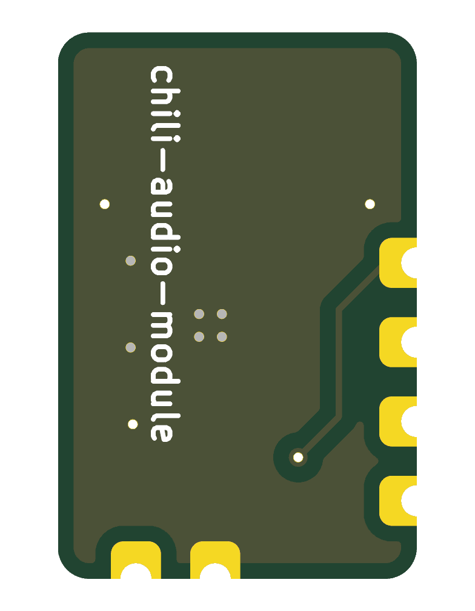
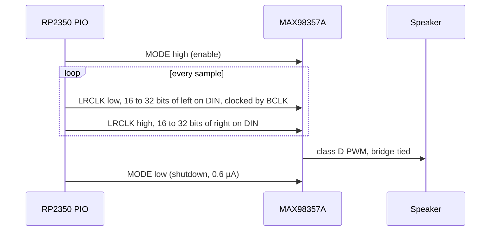
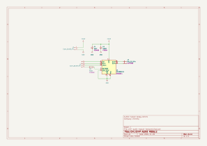

# Audio module

The audio module is a tiny I²S mono speaker amplifier built around the [MAX98357A](https://www.analog.com/media/en/technical-documentation/data-sheets/MAX98357A-MAX98357B.pdf). The RP2350 sends it digital audio, so there is no PWM noise on an analog line. It solders flat onto the back of the console by its castellated edges, and the speaker plugs into it.

Repository: [chili-chip/chili-audio-module-hardware](https://github.com/chili-chip/chili-audio-module-hardware) · Latest release: [v1.1.1](https://github.com/chili-chip/chili-audio-module-hardware/releases/tag/v1.1.1)

{ loading=lazy }

<figure markdown>
{ loading=lazy }
<figcaption>Top</figcaption>
</figure>
<figure markdown>
{ loading=lazy }
<figcaption>Bottom: faces the main board</figcaption>
</figure>

## Specifications

| | |
|---|---|
| Amplifier | MAX98357A: I²S in, filterless class D out, built-in DAC, no MCLK needed |
| Input formats | Standard I²S, left-justified, TDM |
| Sample rates | 8 to 96 kHz |
| Gain | 12 dB (GAIN_SLOT tied to GND) |
| Channel | Mono, (L + R) / 2 mix when MODE is high |
| Supply | 3.3 V |
| Speaker output | Bridge-tied (OUTP/OUTN) on a Molex PicoBlade 1.25 mm 2-pin connector (J3), for 4 to 8 Ω |
| Board | 11.5 × 17.5 mm, 2 layers, 1.6 mm, parts on top only |
| Host connection | 6 castellated half-holes, 2.54 mm pitch |

!!! danger "Do not ground the speaker"
    The output is bridge-tied. Connect the speaker across the two J3 pins and never tie either pin to GND.

## Pinout

Seen from the top, with the speaker connector at the top edge. Positions are pad centres from the board's bottom-left corner.

| Pad | Signal | Edge | Position | Console net | RP2350 GPIO |
|---|---|---|---|---|---|
| J1.1 | DIN | Left | y = 2.50 mm | `AUDIO_DIN` | GP3 |
| J1.2 | BCLK | Left | y = 5.04 mm | `AUDIO_BCLK` | GP4 |
| J1.3 | LRCLK (silkscreen: LCLK) | Left | y = 7.58 mm | `AUDIO_LRCLK` | GP5 |
| J1.4 | MODE | Left | y = 10.12 mm | `AUDIO_MODE` | GP6 |
| J2.1 | 3V3 | Bottom | x = 9.00 mm | 3V3 | |
| J2.2 | GND | Bottom | x = 6.46 mm | GND | |

MODE goes to the amplifier's SD_MODE pin through R1 (510 kΩ). High (3.3 V) turns the amplifier on and mixes left and right. Low shuts it down. Drive it from a GPIO to save power when the console is silent.

## Signals

## Bill of materials

| Ref | Part | Package | LCSC |
|---|---|---|---|
| U1 | MAX98357AETE+T | TQFN-16 3 × 3 mm | [C910544](https://www.lcsc.com/product-detail/C910544.html) |
| J3 | Molex 53261-0271, PicoBlade 2-pin, right angle | SMD | [C177225](https://www.lcsc.com/product-detail/C177225.html) |
| C1 | 10 µF, 6.3 V, X5R | 0402 | [C15525](https://www.lcsc.com/product-detail/C15525.html) |
| C2 | 100 nF, 16 V, X7R | 0402 | [C1525](https://www.lcsc.com/product-detail/C1525.html) |
| R1 | 510 kΩ, 1 % | 0603 | [C23192](https://www.lcsc.com/product-detail/C23192.html) |

J1 and J2 are the castellated edge pads, part of the board itself.

## Schematic

[{ .drawing loading=lazy }](../schematics/audio-module.svg)

## Ordering

Each release has `chili-audio-module-<version>-gerbers.zip`, `-bom.csv` and `-cpl.csv` attached.

1. Download the three files from the [latest release](https://github.com/chili-chip/chili-audio-module-hardware/releases/latest).
2. On [jlcpcb.com](https://jlcpcb.com/), click **Order now** and upload the gerber zip.
3. Set 2 layers, 1.6 mm, **Castellated Holes: Yes**. ENIG is recommended for the QFN and the castellations; HASL also works.
4. Turn on **PCB Assembly**, top side. If Economic assembly is not offered with castellated holes, pick Standard.
5. Upload the BOM and CPL. Check all five parts are matched and in stock. The MAX98357A and the connector are usually extended parts, with a small one-off fee each.
6. In the placement preview, check:
    - U1's pin 1 dot is in the bottom-left corner, by the triangle on the silkscreen.
    - J3's opening faces the top edge, with its two tabs on the large pads.

## Using it on another board

The module works with any 3.3 V microcontroller that outputs I²S (RP2040, RP2350, ESP32 and others).

- Place SMD lands that match the castellations: four along one edge at 2.54 mm pitch, two along the next edge. Use the positions in the pinout.
- Assign `chili-audio-module-hardware.step` to the footprint with no offset. Its origin is the board's bottom-left corner.
- Keep the area under the module free of tall parts.

## Versions

| Version | Date | What changed |
|---|---|---|
| [v1.0.0](https://github.com/chili-chip/chili-audio-module-hardware/releases/tag/v1.0.0) | 27 Oct 2026 | First design, KiCad 10 CI |
| [v1.1.0](https://github.com/chili-chip/chili-audio-module-hardware/releases/tag/v1.1.0) | 5 Nov 2026 | Castellated edge pads, front silkscreen |
| [v1.1.1](https://github.com/chili-chip/chili-audio-module-hardware/releases/tag/v1.1.1) | 5 Nov 2026 | README, JLCPCB release files, silkscreen fix |

Main board v3.0.0 needs v1.1 or later. The chip choice (MAX98357A over NS4168, PAM8302A and HXJ8002) is in [vgc-zero-hardware #23](https://github.com/chili-chip/vgc-zero-hardware/issues/23).
