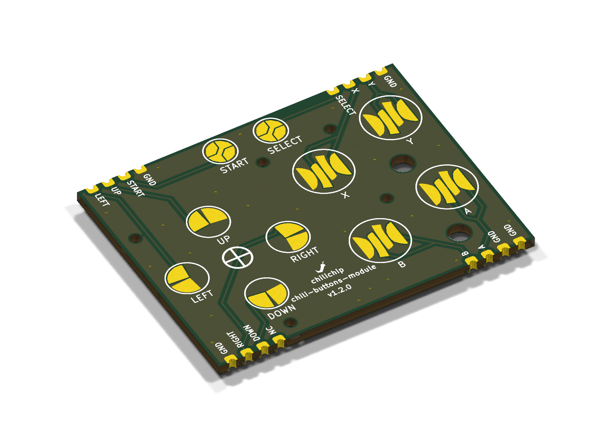
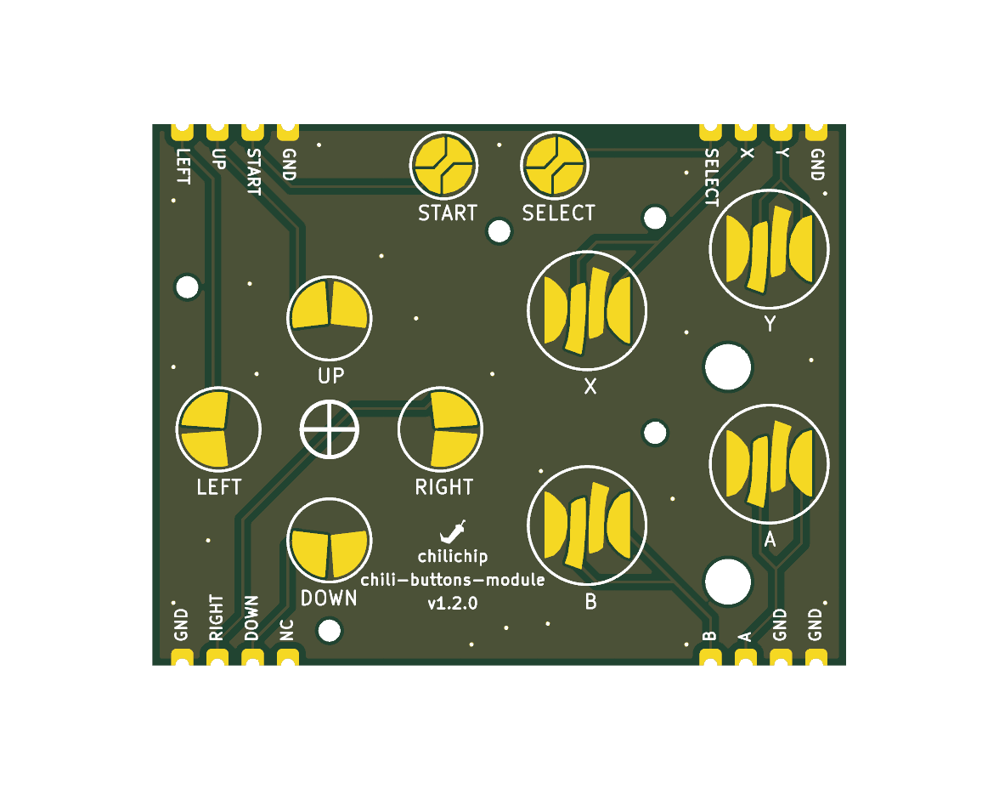
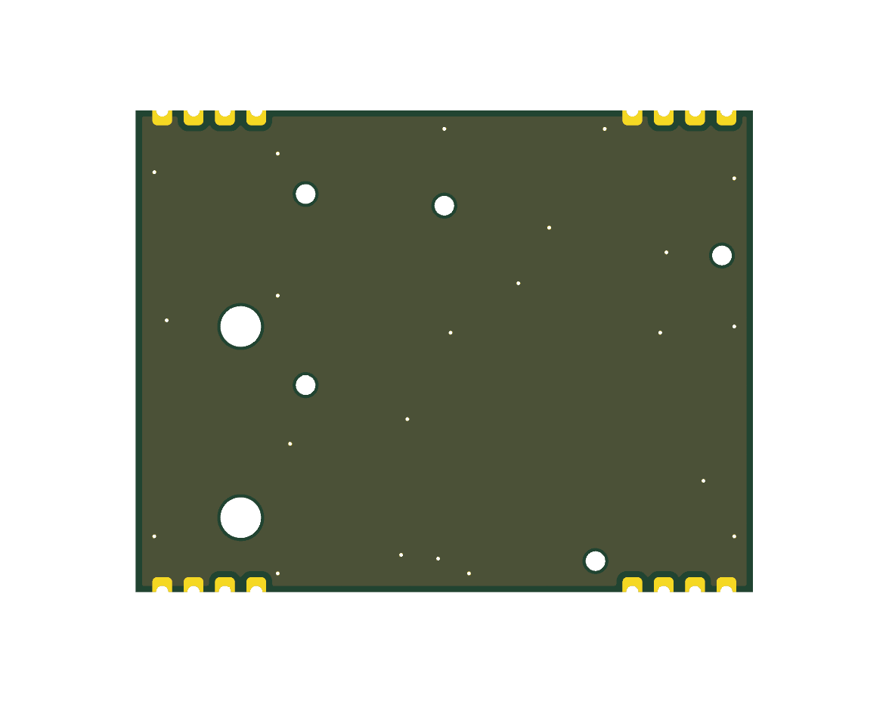
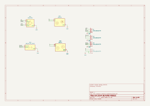

# Buttons module

The buttons module is a Game Boy Advance–style button board: a D-pad, A, B, X, Y, Start and Select. The buttons are bare gold contacts for standard GBA rubber pads, so the board has no parts at all. It solders flat onto the front of the main board, below the display.

Repository: [chili-chip/chili-buttons-module-hardware](https://github.com/chili-chip/chili-buttons-module-hardware)

{ loading=lazy }

<figure markdown>
{ loading=lazy }
<figcaption>Top: contacts</figcaption>
</figure>
<figure markdown>
{ loading=lazy }
<figcaption>Bottom: faces the main board</figcaption>
</figure>

## Versions

| Version | Released | What changed | Fits main board |
|---|---|---|---|
| v1.1.0 | [Yes, 4 Nov 2026](https://github.com/chili-chip/chili-buttons-module-hardware/releases/tag/v1.1.0) | 4-pin headers on a 2.54 mm grid, ENIG, A/B fix, ON/OFF button | None released |
| v1.2.0 | **Not tagged yet** | Castellated edge pads, ON/OFF button removed, detailed 3D model | v3.0.0 |

!!! warning "v1.2.0 is not released yet"
    Main board v3.0.0 needs buttons module v1.2.0, which is merged on `master` but has no tag or release. Order it from a checkout of `master` until `v1.2.0` is tagged. This page describes v1.2.0.

## Specifications

| | |
|---|---|
| Buttons | Up, Down, Left, Right, A, B, X, Y, Start, Select |
| Contacts | Interleaved bare copper for carbon rubber pads, ENIG finish |
| Switching | Each button shorts its signal to GND. No pull-ups on the module |
| Board | 50 × 39 mm, 2 layers, 1.6 mm, **ENIG required** |
| Host connection | 16 castellated half-holes, 2.54 mm pitch, in 4 groups of 4 |
| Parts | None. The rubber pads locate on the board's non-plated holes |

Enable the RP2350's internal pull-ups and read a pressed button as low.

## Pinout

Seen from the top, with Start and Select at the top edge. Positions are pad centres from the board's bottom-left corner. Pin 1 of each group is its leftmost pad.

**Top edge** (y = 39.0 mm)

| Group | Pin 1 | Pin 2 | Pin 3 | Pin 4 |
|---|---|---|---|---|
| J1, x = 2.14 to 9.76 mm | LEFT | UP | START | GND |
| J2, x = 40.24 to 47.86 mm | SELECT | X | Y | GND |

**Bottom edge** (y = 0 mm)

| Group | x = 2.14 | x = 4.68 | x = 7.22 | x = 9.76 |
|---|---|---|---|---|
| J3 | GND (pin 4) | RIGHT (pin 3) | DOWN (pin 2) | NC (pin 1) |

| Group | x = 40.24 | x = 42.78 | x = 45.32 | x = 47.86 |
|---|---|---|---|---|
| J4 | B (pin 1) | A (pin 2) | GND (pin 3) | GND (pin 4) |

J3 pin 1 is not connected. It carried the ON/OFF button until v1.2.0. The pad stays so the 4 × 4 layout does not change.

## On the console

| Button | Pad | Net | RP2350 GPIO |
|---|---|---|---|
| Up | J1.2 | `BTN_UP` | GP19 |
| Down | J3.2 | `BTN_DOWN` | GP16 |
| Left | J1.1 | `BTN_LEFT` | GP20 |
| Right | J3.3 | `BTN_RIGHT` | GP17 |
| A | J4.2 | `BTN_A` | GP7 |
| B | J4.1 | `BTN_B` | GP8 |
| X | J2.2 | `BTN_X` | GP11 |
| Y | J2.3 | `BTN_Y` | GP10 |
| Start | J1.3 | `BTN_START` | GP18 |
| Select | J2.1 | `BTN_SELECT` | GP12 |

## Rubber pads

The contacts are sized for standard Game Boy Advance silicone pads: one D-pad pad, one A/B pad and one Start/Select pad. X and Y use A/B-style domes. The carbon pill under each dome bridges the interleaved contacts when pressed.

| Tip | Why |
|---|---|
| Buy two or three brands | Feel and contact quality differ between makers |
| Keep the contacts clean | Flux or finger grease raises the contact resistance. Clean with isopropyl alcohol |
| Use ENIG only | HASL is not flat and oxidises. Carbon pads need flat gold |

A custom silicone keypad for larger runs is tracked in [vgc-zero-hardware #33](https://github.com/chili-chip/vgc-zero-hardware/issues/33).

## Schematic

[{ .drawing loading=lazy }](../schematics/buttons-module.svg)

## Ordering

1. Download the gerber zip from a [release](https://github.com/chili-chip/chili-buttons-module-hardware/releases), or run `scripts/export-jlcpcb.sh` on a checkout (needs KiCad 10's `kicad-cli` and `zip`).
2. On [jlcpcb.com](https://jlcpcb.com/), click **Order now** and upload the zip.
3. Set 2 layers, 1.6 mm, **ENIG**, **Castellated Holes: Yes**. Leave the rest at the defaults.
4. Leave **PCB Assembly** off. There is nothing to place.

## Credits

The GBA button contact footprints come from the [Pigweed Kudzu](https://pigweed.googlesource.com/pigweed/kudzu/+/refs/heads/main/pcb/) badge, licensed CC BY 4.0.
