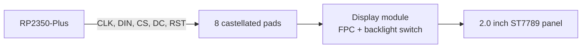

# Display

From the next main board on, the console has one screen: a **2.0" IPS TFT, 320 × 240**, mounted sideways (decided 2026-11-27). It sits on a chilichip display module. Board v3.0.0 still uses the Waveshare OLED module.

| | v3.0.0 (today) | Next board |
|---|---|---|
| Screen | [Waveshare 1.5" RGB OLED Module](https://www.waveshare.com/wiki/1.5inch_RGB_OLED_Module) | 2.0" IPS TFT panel, [EastRising ER-TFT020-3](https://www.buydisplay.com/2-inch-240x320-ips-tft-lcd-display-with-connector-fpc) |
| Controller | SSD1351 | ST7789 |
| Resolution | 128 × 128 | 320 × 240 (games today: 128 × 128 scaled to 240 × 240) |
| Light | Self-lit pixels | LED backlight, 300 cd/m² |
| Connection | 7-pin 2.54 mm header | Display module with 8 castellated pads |
| Size | 44.5 × 37 mm, four holes | Panel 47.8 × 34.6 mm on the frame, module 28 × 22 mm flat on the main board |
| Design files | Waveshare | [chili-display-module-hardware](https://github.com/chili-chip/chili-display-module-hardware) |

The sections below up to [Display module](#display-module) describe the Waveshare module on board v3.0.0.

The OLED sits on the front of the console, on a 7-pin 2.54 mm header and four standoffs.

## Specifications

| | |
|---|---|
| Panel | 1.5" OLED, 128 × 128 pixels, self-lit (no backlight) |
| Controller | [SSD1351](https://www.waveshare.com/w/upload/a/a7/SSD1351-Revision_1.5.pdf) |
| Colour depth | 262k (18-bit) in the controller; the firmware sends 65k (RGB565) |
| Interface | 4-wire SPI, write only, plus DC and RST |
| SPI clock | 20 MHz in the firmware (the SSD1351's 50 ns write cycle) |
| Full frame | 32 KB, about 13 ms on the wire at 20 MHz |
| Supply | 3.3 V |
| Module size | 44.5 × 37 mm |
| Mounting | 7-pin header, four 2 mm holes |

## Pinout

The header pins are numbered as on the Waveshare module.

| Pin | Module label | Net | RP2350 GPIO |
|---|---|---|---|
| 1 | VCC | 3V3 | |
| 2 | GND | GND | |
| 3 | DIN | `DISP_DIN` | GP27 (SPI1 TX) |
| 4 | CLK | `DISP_CLK` | GP26 (SPI1 SCK) |
| 5 | CS | `DISP_CS` | GP28 |
| 6 | DC | `DISP_DC` | GP22 |
| 7 | RST | `DISP_RST` | GP21 |

The panel has no TE (tearing effect) pin on this module, so the firmware cannot sync to the panel's refresh.

## Brightness

An OLED has no backlight. Brightness is the SSD1351's contrast setting, which the firmware sets over SPI. Black pixels are off and draw no power, so dark games use less battery.

## Display module

From the next main board on, the screen is a 2.0" ER-TFT020-3 panel on a chilichip display module ([chili-display-module-hardware](https://github.com/chili-chip/chili-display-module-hardware)).

### Panel

| | |
|---|---|
| Panel | 2.0" IPS TFT, 320 × 240, mounted sideways |
| Controller | ST7789 |
| Outline | 47.8 × 34.6 × 2.05 mm, active area 40.8 × 30.6 mm |
| Interface | 4-wire SPI, plus DC and RST. No TE pin |
| SPI clock | 62.5 MHz in the firmware, about 15 ms per scaled frame |
| Supply | 3.3 V. Backlight 3 LEDs in parallel, about 44 mA |
| Tail | 14-pin 0.5 mm FPC, leaves the left short edge off centre and folds back under the panel |

Today's games draw 128 × 128 and the firmware scales them to 240 × 240 in the middle of the panel ([32blit-sdk #114](https://github.com/chili-chip/32blit-sdk/pull/114)). Full 320 × 240 for new games is [32blit-sdk #115](https://github.com/chili-chip/32blit-sdk/issues/115).

### How it sits on the main board

The panel is not on the module. It is glued or screwed to the console frame, and its flex tail plugs into the FPC connector at the module's bottom edge. The module only holds the connector and the backlight switch.

All module parts are on its top side, so its bottom is flat. The module (28 × 22 mm) lies flat on the main board and is hand soldered by 8 castellated pads, 4 on the left edge and 4 on the right, like a Raspberry Pi Pico. It stands 3.6 mm above the main board: 1.6 mm board plus the 2.0 mm FPC connector. The connector is off centre, towards the left pads, so the folded tail reaches it.

```
        module 28 mm
 +---------------------------+
 |  parts on top             |   panel above, on the frame
pad                         pad
pad   flat bottom on the    pad   pads soldered by hand
pad   main board            pad   to the main board
pad                         pad
 +-----[J2]------------------+
       FPC
```

Keep parts and bare copper out from under the module. Tracks and tented vias are fine. The main board footprint is `ChiliDisplayModule_Host` in the module repo.

### Pads

Same five signals and GPIOs as the Waveshare module, so the firmware pin map doesn't change.

| Pad | Edge | Net | RP2350 GPIO |
|---|---|---|---|
| 1 | Left | 3V3 | |
| 2 | Left | GND | |
| 3 | Left | `DISP_DIN` | GP27 (SPI1 TX) |
| 4 | Left | `DISP_CLK` | GP26 (SPI1 SCK) |
| 5 | Right | `DISP_CS` | GP28 |
| 6 | Right | `DISP_DC` | GP22 |
| 7 | Right | `DISP_RST` | GP21 |
| 8 | Right | GND | |

### Backlight follows `DISP_RST`

All 26 GPIOs are used, so the reset line also switches the backlight:

| `DISP_RST` | Backlight |
|---|---|
| High (running) | On |
| Low (reset, sleep) | Off |

In sleep mode the firmware holds `DISP_RST` low, so the module draws almost nothing ([32blit-sdk #97](https://github.com/chili-chip/32blit-sdk/issues/97)). The display is re-initialised on wake anyway. There is no brightness control.



## History

| Board | How the display was connected |
|---|---|
| Breadboard prototype | 1.44" ST7735S TFT |
| v1.1.4 | Waveshare 1.5" OLED on a 7-pin JST cable |
| v2.0.0, v3.0.0 | Same module, on a 2.54 mm pin header ([#21](https://github.com/chili-chip/vgc-zero-hardware/issues/21)) |
| Next board | 2.0" ER-TFT020-3 panel on a chilichip display module, castellated, flat on the main board |

A switch from the OLED to a TFT IPS panel was dropped in 2026-10. On 2026-11-13 the TFT came back as a second, cheaper version next to the OLED ([#41](https://github.com/chili-chip/vgc-zero-hardware/issues/41)). On 2026-11-25 both moved to chilichip castellated display modules soldered flat on the main board. On 2026-11-27 the small screens were dropped: the console now uses only the 2.0" 320 × 240 TFT, which fits the new casing.

## Footprints

| Footprint | Use |
|---|---|
| `SSD1351_OLED_128x128_WAVESHARE` | The Waveshare module (44.5 × 37 mm). Used on v3.0.0 |
| `SSD1351_OLED_128x128` | Generic 128 × 128 SSD1351 modules |

## Links

| | |
|---|---|
| Product wiki | [Waveshare 1.5inch RGB OLED Module](https://www.waveshare.com/wiki/1.5inch_RGB_OLED_Module) |
| Firmware driver | [Display driver](https://sdk.chilichip.eu/console/display/) in the SDK docs |
| 3D model | `3d-models/1_5inch-rgb-oled-module_asm-1110.stp` |
