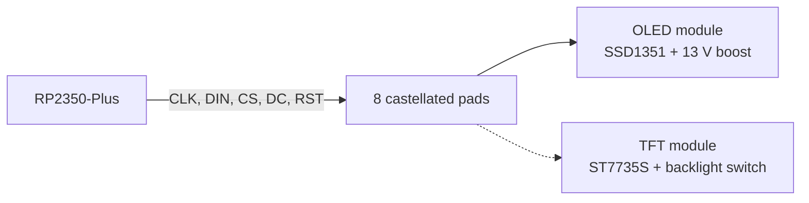

# Display

The console comes in two versions: **OLED** and **TFT** ([#41](https://github.com/chili-chip/vgc-zero-hardware/issues/41)). Both use a chilichip display module with the same outline and pads, so the screen is swappable. Board v3.0.0 still uses the Waveshare OLED module.

| | v3.0.0 (today) | OLED module (next board) | TFT module (next board) |
|---|---|---|---|
| Screen | [Waveshare 1.5" RGB OLED Module](https://www.waveshare.com/wiki/1.5inch_RGB_OLED_Module) | 1.5" OLED panel, EastRising ER-OLED015-1C | 1.44" TFT panel, EastRising ER-TFT1.44-3 |
| Controller | SSD1351 | SSD1351 | ST7735S |
| Resolution | 128 × 128 | 128 × 128 | 128 × 128 |
| Light | Self-lit pixels | Self-lit pixels | LED backlight |
| Connection | 7-pin 2.54 mm header | 8 castellated pads | 8 castellated pads |
| Size | 44.5 × 37 mm, four holes | 28 × 22 mm, sits in a hole in the main board | Same as the OLED module |
| Design files | Waveshare | [chili-display-module-hardware](https://github.com/chili-chip/chili-display-module-hardware) | Same repo |

The sections below up to [Display modules](#display-modules) describe the Waveshare module on board v3.0.0.

The OLED sits on the front of the console, on a 7-pin 2.54 mm header and four standoffs.

## Specifications

| | |
|---|---|
| Panel | 1.5" OLED, 128 × 128 pixels, self-lit (no backlight) |
| Controller | [SSD1351](https://www.waveshare.com/w/upload/a/a7/SSD1351-Revision_1.5.pdf) |
| Colour depth | 262k (18-bit) in the controller; the firmware sends 65k (RGB565) |
| Interface | 4-wire SPI, write only, plus DC and RST |
| SPI clock | 20 MHz in the firmware (the SSD1351's 50 ns write cycle) |
| Full frame | 32 KB, about 13 ms on the wire at 20 MHz |
| Supply | 3.3 V |
| Module size | 44.5 × 37 mm |
| Mounting | 7-pin header, four 2 mm holes |

## Pinout

The header pins are numbered as on the Waveshare module.

| Pin | Module label | Net | RP2350 GPIO |
|---|---|---|---|
| 1 | VCC | 3V3 | |
| 2 | GND | GND | |
| 3 | DIN | `DISP_DIN` | GP27 (SPI1 TX) |
| 4 | CLK | `DISP_CLK` | GP26 (SPI1 SCK) |
| 5 | CS | `DISP_CS` | GP28 |
| 6 | DC | `DISP_DC` | GP22 |
| 7 | RST | `DISP_RST` | GP21 |

The panel has no TE (tearing effect) pin on this module, so the firmware cannot sync to the panel's refresh.

## Brightness

An OLED has no backlight. Brightness is the SSD1351's contrast setting, which the firmware sets over SPI. Black pixels are off and draw no power, so dark games use less battery.

## Display modules

From the next main board on, the screen is a chilichip display module ([chili-display-module-hardware](https://github.com/chili-chip/chili-display-module-hardware)). There are two: OLED and TFT. The TFT version saves about €11–12 per console ([chili-business #60](https://github.com/chili-chip/chili-business/issues/60)). Games don't change, because the resolution is the same.

### How it sits on the main board

The panel is not on the module. It is glued or screwed to the console frame, and its flex tail wraps round the module's bottom edge into the FPC connector. The module only holds the connector and the power parts.

The main board has a 23 × 24 mm hole under the module. The module (28 × 22 mm) rests on two 2.5 mm ledges, left and right, and is soldered by 8 castellated pads. Its parts (FPC connector, passives, boost) are on the bottom and sit inside the hole. This saves the height of a pin header and standoffs.

```
      module 28 mm
 +----+------------------+----+
 |pad |                  | pad|   panel above, on the frame
 |pad |   hole in the    | pad|
 |pad |   main board     | pad|   module parts hang into the hole
 |pad |                  | pad|
 +----+------------------+----+
  2.5 mm ledge      2.5 mm ledge
```

The main board footprint (pads and cut-out) is `ChiliDisplayModule_Host` in the module repo.

### Pads

Same five signals and GPIOs as the Waveshare module, so the firmware pin map doesn't change.

| Pad | Edge | Net | RP2350 GPIO |
|---|---|---|---|
| 1 | Left | 3V3 | |
| 2 | Left | GND | |
| 3 | Left | `DISP_DIN` | GP27 (SPI1 TX) |
| 4 | Left | `DISP_CLK` | GP26 (SPI1 SCK) |
| 5 | Right | `DISP_CS` | GP28 |
| 6 | Right | `DISP_DC` | GP22 |
| 7 | Right | `DISP_RST` | GP21 |
| 8 | Right | GND | |

### Power follows `DISP_RST`

All 26 GPIOs are used, so each module uses the reset line as its on/off switch:

| `DISP_RST` | TFT module | OLED module |
|---|---|---|
| High (running) | Backlight on | 13 V panel supply on |
| Low (reset, sleep) | Backlight off | 13 V supply off |

In sleep mode the firmware holds `DISP_RST` low, so the module draws almost nothing ([32blit-sdk #97](https://github.com/chili-chip/32blit-sdk/issues/97)). The display is re-initialised on wake anyway. There is no brightness control on the TFT module.



### Which screen is fitted

One firmware image drives both screens. At boot the loader asks the panel for its ID on the DIN line. The ST7735S answers; the SSD1351 is write only and stays silent. The loader then picks the matching driver ([32blit-sdk #108](https://github.com/chili-chip/32blit-sdk/issues/108)).

## History

| Board | How the display was connected |
|---|---|
| Breadboard prototype | 1.44" ST7735S TFT |
| v1.1.4 | Waveshare 1.5" OLED on a 7-pin JST cable |
| v2.0.0, v3.0.0 | Same module, on a 2.54 mm pin header ([#21](https://github.com/chili-chip/vgc-zero-hardware/issues/21)) |
| Next board | chilichip OLED or TFT module, castellated, in a hole in the main board ([#41](https://github.com/chili-chip/vgc-zero-hardware/issues/41)) |

A switch from the OLED to a TFT IPS panel was dropped in 2026-10. On 2026-11-13 the TFT came back as a second, cheaper version next to the OLED ([#41](https://github.com/chili-chip/vgc-zero-hardware/issues/41)). On 2026-11-25 both moved to chilichip castellated display modules that sit in a hole in the main board. The OLED module uses a bare SSD1351 panel, the idea first planned for a fully assembled board ([chilichip-console-hardware #16](https://github.com/chili-chip/chilichip-console-hardware/issues/16)).

## Footprints

| Footprint | Use |
|---|---|
| `SSD1351_OLED_128x128_WAVESHARE` | The Waveshare module (44.5 × 37 mm). Used on v3.0.0 |
| `SSD1351_OLED_128x128` | Generic 128 × 128 SSD1351 modules |

## Links

| | |
|---|---|
| Product wiki | [Waveshare 1.5inch RGB OLED Module](https://www.waveshare.com/wiki/1.5inch_RGB_OLED_Module) |
| Firmware driver | [Display driver](https://sdk.chilichip.eu/console/display/) in the SDK docs |
| 3D model | `3d-models/1_5inch-rgb-oled-module_asm-1110.stp` |
