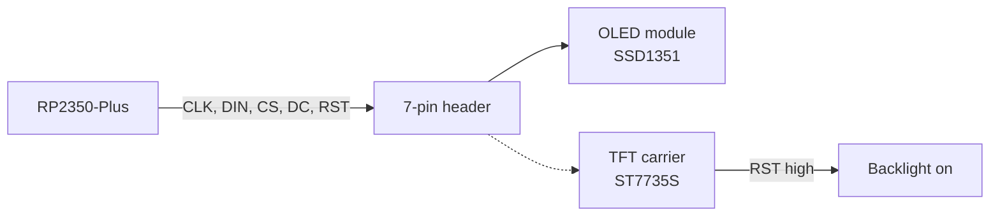

# Display

The console comes in two versions: **OLED** and **TFT** ([#41](https://github.com/chili-chip/vgc-zero-hardware/issues/41)). The screen is swappable: both screens plug into the same 7-pin header and use the same GPIOs.

| | OLED version | TFT version |
|---|---|---|
| Screen | [Waveshare 1.5inch RGB OLED Module](https://www.waveshare.com/wiki/1.5inch_RGB_OLED_Module) | 1.44" TFT on a chilichip carrier board (in design) |
| Controller | SSD1351 | ST7735S |
| Resolution | 128 × 128 | 128 × 128 |
| Light | Self-lit pixels | LED backlight |
| Connector | 7-pin 2.54 mm header | Same header, same pin order |
| Size and holes | 44.5 × 37 mm, four holes | Same as the OLED |
| Status | Used on v3.0.0 | Panel not picked yet |

The rest of this page describes the OLED module. The [TFT version](#tft-version) section covers what is different.

The OLED sits on the front of the console, on a 7-pin 2.54 mm header and four standoffs.

## Specifications

| | |
|---|---|
| Panel | 1.5" OLED, 128 × 128 pixels, self-lit (no backlight) |
| Controller | [SSD1351](https://www.waveshare.com/w/upload/a/a7/SSD1351-Revision_1.5.pdf) |
| Colour depth | 262k (18-bit) in the controller; the firmware sends 65k (RGB565) |
| Interface | 4-wire SPI, write only, plus DC and RST |
| SPI clock | 20 MHz in the firmware (the SSD1351's 50 ns write cycle) |
| Full frame | 32 KB, about 13 ms on the wire at 20 MHz |
| Supply | 3.3 V |
| Module size | 44.5 × 37 mm |
| Mounting | 7-pin header, four 2 mm holes |

## Pinout

The header pins are numbered as on the Waveshare module.

| Pin | Module label | Net | RP2350 GPIO |
|---|---|---|---|
| 1 | VCC | 3V3 | |
| 2 | GND | GND | |
| 3 | DIN | `DISP_DIN` | GP27 (SPI1 TX) |
| 4 | CLK | `DISP_CLK` | GP26 (SPI1 SCK) |
| 5 | CS | `DISP_CS` | GP28 |
| 6 | DC | `DISP_DC` | GP22 |
| 7 | RST | `DISP_RST` | GP21 |

The panel has no TE (tearing effect) pin on this module, so the firmware cannot sync to the panel's refresh.

## Brightness

An OLED has no backlight. Brightness is the SSD1351's contrast setting, which the firmware sets over SPI. Black pixels are off and draw no power, so dark games use less battery.

## TFT version

The TFT version uses a 1.44" 128 × 128 panel with an ST7735S controller. It saves about €11–12 per console ([chili-business #60](https://github.com/chili-chip/chili-business/issues/60)). Games don't change, because the resolution is the same.

### Carrier board

The bare panel has a thin flex cable (FPC), so it sits on a small assembled carrier board. The carrier copies the Waveshare module:

- the same 7-pin header, at the same place and in the same pin order;
- the same 44.5 × 37 mm outline and four mounting holes;
- the panel's visible area centred where the OLED's is, so the shell fits both.

The main board doesn't change. To swap screens, unplug one and plug in the other.

### Backlight

All 26 GPIOs are used, so there is no pin for the backlight. A transistor on the carrier switches it from `DISP_RST`:

| `DISP_RST` | Panel | Backlight |
|---|---|---|
| High | Running | On |
| Low | Held in reset | Off |

In sleep mode the firmware holds `DISP_RST` low, so the backlight draws nothing ([32blit-sdk #97](https://github.com/chili-chip/32blit-sdk/issues/97)). The display is re-initialised on wake anyway. There is no brightness control on the TFT version.

### Which screen is fitted

One firmware image drives both screens. At boot the loader asks the panel for its ID on the DIN line. The ST7735S answers; the SSD1351 is write only and stays silent. The loader then picks the matching driver ([32blit-sdk #108](https://github.com/chili-chip/32blit-sdk/issues/108)).

## History

| Board | How the display was connected |
|---|---|
| Breadboard prototype | 1.44" ST7735S TFT |
| v1.1.4 | Waveshare 1.5" OLED on a 7-pin JST cable |
| v2.0.0 and later | Same module, on a 2.54 mm pin header ([#21](https://github.com/chili-chip/vgc-zero-hardware/issues/21)) |

A switch from the OLED to a TFT IPS panel was dropped in 2026-10. On 2026-11-13 the TFT came back as a second, cheaper version next to the OLED ([#41](https://github.com/chili-chip/vgc-zero-hardware/issues/41)). A cheaper bare SSD1351 panel is planned only for a future fully assembled board ([chilichip-console-hardware #16](https://github.com/chili-chip/chilichip-console-hardware/issues/16)).

## Footprints

| Footprint | Use |
|---|---|
| `SSD1351_OLED_128x128_WAVESHARE` | The Waveshare module (44.5 × 37 mm). Used on v3.0.0 |
| `SSD1351_OLED_128x128` | Generic 128 × 128 SSD1351 modules |

## Links

| | |
|---|---|
| Product wiki | [Waveshare 1.5inch RGB OLED Module](https://www.waveshare.com/wiki/1.5inch_RGB_OLED_Module) |
| Firmware driver | [Display driver](https://sdk.chilichip.eu/console/display/) in the SDK docs |
| 3D model | `3d-models/1_5inch-rgb-oled-module_asm-1110.stp` |
