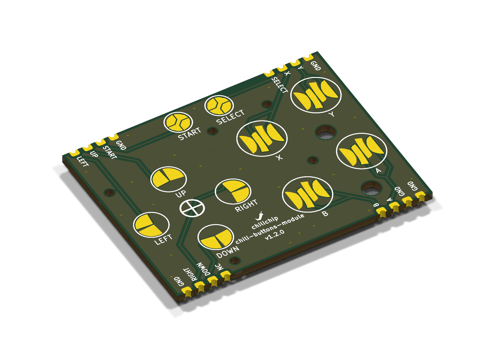
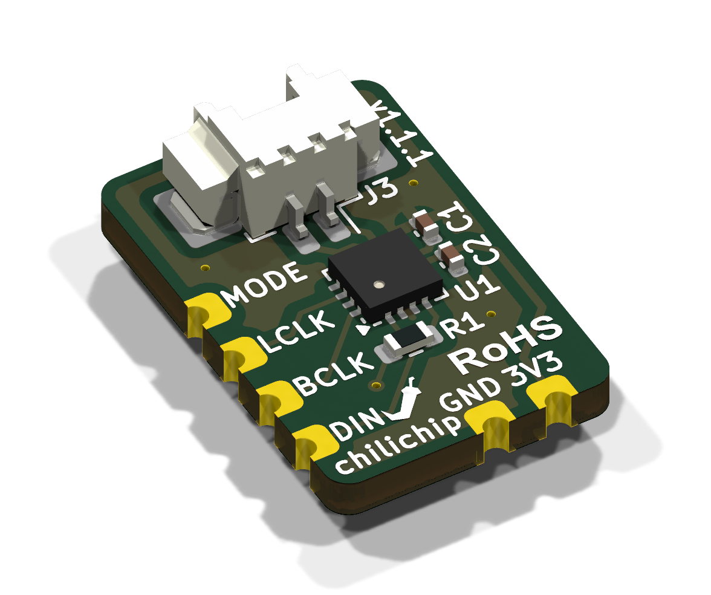
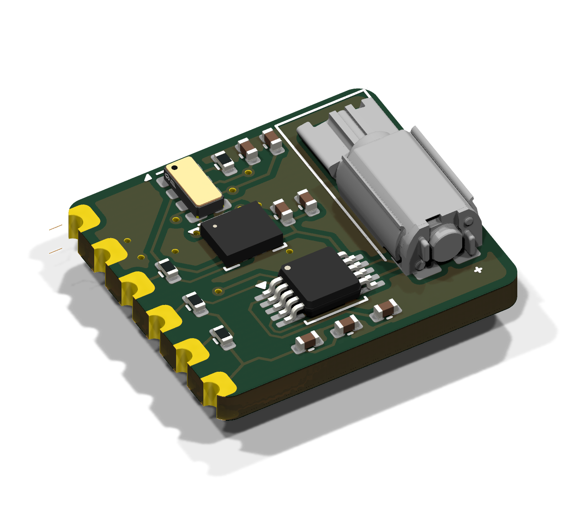
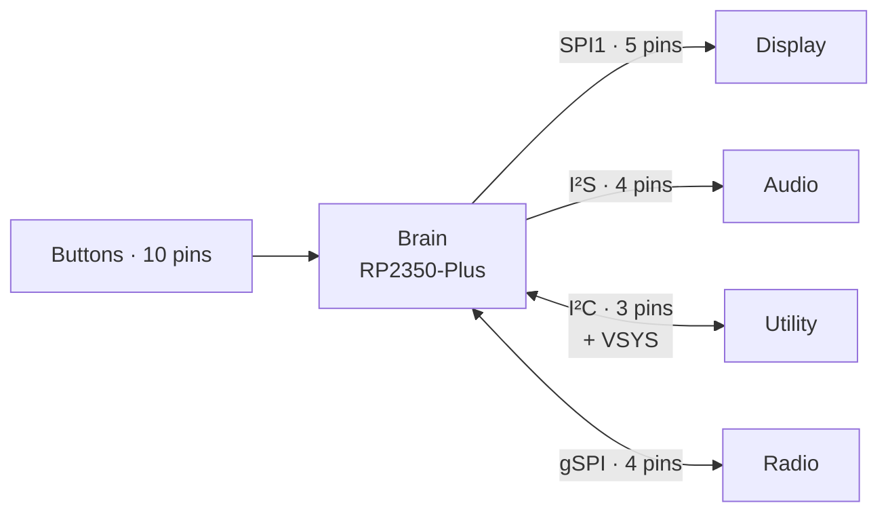

# Modules

The console is made of modules. Each one does one job and talks to the RP2350 over its own pins.

- **Our modules** (audio, utility, buttons) are tiny boards with castellated edges. JLCPCB assembles the parts on them. You solder them flat onto the main board.
- **Bought modules** (brain, display, radio) are ready-made boards from Waveshare and Raspberry Pi.

## Overview

| Module | Job | Made by | Version on v3.0.0 | Size (mm) | Side | GPIOs | Repository |
|---|---|---|---|---|---|---|---|
| [Brain](brain.md) | Processor, flash, USB, charger, 3.3 V | Waveshare (RP2350-Plus) | 16 MB version | 23 × 54 | Back | | |
| [Display](display.md) | 1.5" OLED screen | Waveshare | 1.5inch RGB OLED Module | 44.5 × 37 | Front | 5 | |
| [Buttons](buttons.md) | 10 game buttons | chilichip | v1.2.0 | 50 × 39 | Front | 10 | [chili-buttons-module-hardware](https://github.com/chili-chip/chili-buttons-module-hardware) |
| [Audio](audio.md) | I²S amplifier for the speaker | chilichip | v1.1.1 | 11.5 × 17.5 | Back | 4 | [chili-audio-module-hardware](https://github.com/chili-chip/chili-audio-module-hardware) |
| [Utility](utility.md) | Motion sensor, clock, vibration | chilichip | v2.0.0 | 16.4 × 14.8 | Back | 3 | [chili-utility-module-hardware](https://github.com/chili-chip/chili-utility-module-hardware) |
| [Radio](radio.md) | Wi-Fi and Bluetooth | Raspberry Pi (RM2) | Radio Module 2 | 16.5 × 14.5 | Back | 4 | |

<figure markdown>
{ loading=lazy }
<figcaption>Buttons module</figcaption>
</figure>
<figure markdown>
{ loading=lazy }
<figcaption>Audio module</figcaption>
</figure>
<figure markdown>
{ loading=lazy }
<figcaption>Utility module</figcaption>
</figure>

## The castellated module standard

Our modules share one way of connecting to a host board, so a footprint drawn once works for every board.

| | |
|---|---|
| Edge pads | Plated half-holes on the board edge, 1.0 mm drill |
| Pad size | 2.4 × 1.6 mm |
| Pitch | 2.54 mm, on a 0.1" grid |
| Board | 2 layers, 1.6 mm, all parts on the top side |
| On the host | Matching SMD lands. No parts and no exposed vias under the module |
| 3D model | A STEP file per module with its origin at the bottom-left corner, so the host footprint can use it with no offset |
| Power | 3.3 V and GND from the host |

To solder one: put flux on the host lands, line the module up with the silkscreen outline, tack two opposite corners, check it is flat, then run solder into each half-hole.

## How modules connect

## Planned modules

These modules are ideas from the [modules tracking issue](https://github.com/chili-chip/vgc-zero-hardware/issues/32). They are not designed yet.

| Module | Idea | Issue |
|---|---|---|
| Keyboard | A keyboard module | None yet |
| Own brain board | An RP2350 board of our own instead of the RP2350-Plus | None yet |

## Issues

| Module | Issue |
|---|---|
| All modules | [#32 Console modules: tracking issue](https://github.com/chili-chip/vgc-zero-hardware/issues/32) |
| Buttons | [#31 Buttons module](https://github.com/chili-chip/vgc-zero-hardware/issues/31), [#33 Classic rubber dome feel](https://github.com/chili-chip/vgc-zero-hardware/issues/33) |
| Display | [#21 Display on a pin header](https://github.com/chili-chip/vgc-zero-hardware/issues/21) |
| Audio | [#20 Audio circuit](https://github.com/chili-chip/vgc-zero-hardware/issues/20), [#23 Audio chip](https://github.com/chili-chip/vgc-zero-hardware/issues/23), [#24 Audio module board](https://github.com/chili-chip/vgc-zero-hardware/issues/24) |
| Utility | [#19 Gyroscope and vibrator](https://github.com/chili-chip/vgc-zero-hardware/issues/19), [chili-utility-module-hardware #2](https://github.com/chili-chip/chili-utility-module-hardware/issues/2) |
| Radio | [#25 Wi-Fi and Bluetooth with the RM2](https://github.com/chili-chip/vgc-zero-hardware/issues/25) |
