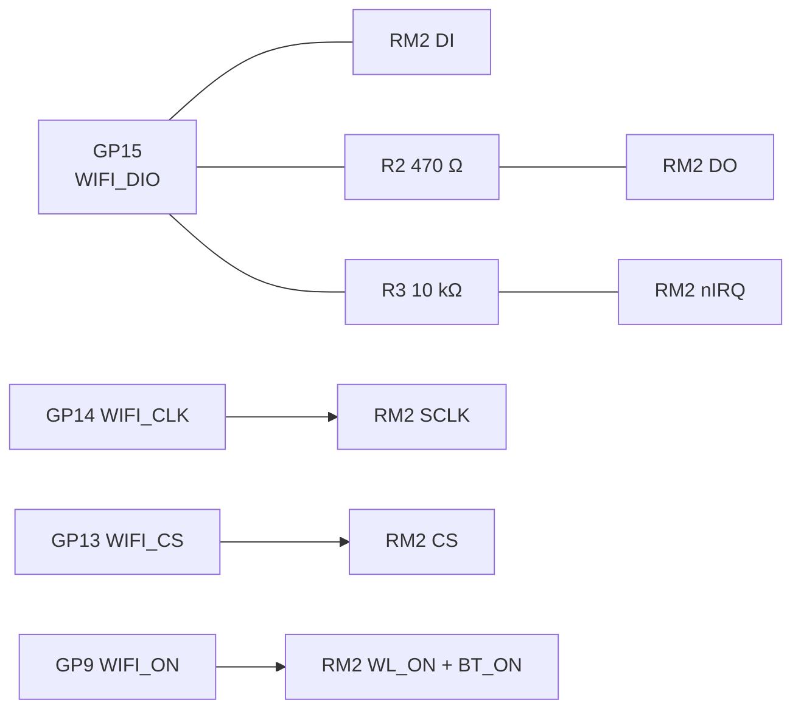

# Radio: Raspberry Pi Radio Module 2

Wi-Fi and Bluetooth come from the [Raspberry Pi Radio Module 2](https://www.raspberrypi.com/products/radio-module-2/) (RM2). It has the same Infineon CYW43439 radio as the Pico 2 W, so the Pico SDK's `cyw43` driver works with it. The RM2 solders flat onto the back of the console at the bottom edge.

## Specifications

| | |
|---|---|
| Chip | Infineon CYW43439 |
| Wi-Fi | 802.11b/g/n, 2.4 GHz, single band |
| Bluetooth | 5.2, Classic and Low Energy |
| Antenna | On the module |
| Interface | gSPI (one shared data line), plus power-on |
| Supply | 3.3 V from the RP2350-Plus |
| Size | 16.5 × 14.5 mm, castellated |
| Footprint | `RF_Module:RMC20452T` (KiCad library), symbol `RPI_RMC20452T.kicad_sym` from Raspberry Pi |

## Wiring

The RM2 is wired like the radio on a Pico W. One GPIO carries data both ways and the interrupt:

| RP2350 GPIO | Net | RM2 pin | Notes |
|---|---|---|---|
| GP9 | `WIFI_ON` | WL_ON, BT_ON | Low turns the radio off |
| GP13 | `WIFI_CS` | CS | |
| GP14 | `WIFI_CLK` | SCLK | |
| GP15 | `WIFI_DIO` | DI, DO (via R2), nIRQ (via R3) | |

!!! note "Not the Pico 2 W pins"
    On a Pico 2 W the radio uses GP23, GP24, GP25 and GP29, which are not on the RP2350-Plus header. The firmware's board file must set the CYW43 pins to GP9, GP13, GP14 and GP15. The `cyw43` driver runs the link from PIO, so any free pins work.

## Antenna

The antenna is at the bottom edge of the console, over an area with no copper on either layer. Follow Raspberry Pi's rules for the keep-out:

- Keep the module at the board edge, antenna outwards.
- No copper, metal screws, battery or display near the antenna.
- In the shell, keep fingers and metal away from that end.

## Firmware

Wi-Fi and Bluetooth are not in the console firmware yet. They are tracked in [32blit-sdk #64](https://github.com/chili-chip/32blit-sdk/issues/64), and signing in to the platform over Wi-Fi in [32blit-sdk #65](https://github.com/chili-chip/32blit-sdk/issues/65).

## Links

| | |
|---|---|
| Product page | [Raspberry Pi Radio Module 2](https://www.raspberrypi.com/products/radio-module-2/) |
| Documentation | [Radio modules](https://www.raspberrypi.com/documentation/microcontrollers/radio-modules.html) |
| Issue | [vgc-zero-hardware #25](https://github.com/chili-chip/vgc-zero-hardware/issues/25) |
| 3D model | `3d-models/rpi_rmc20452t.step` |
