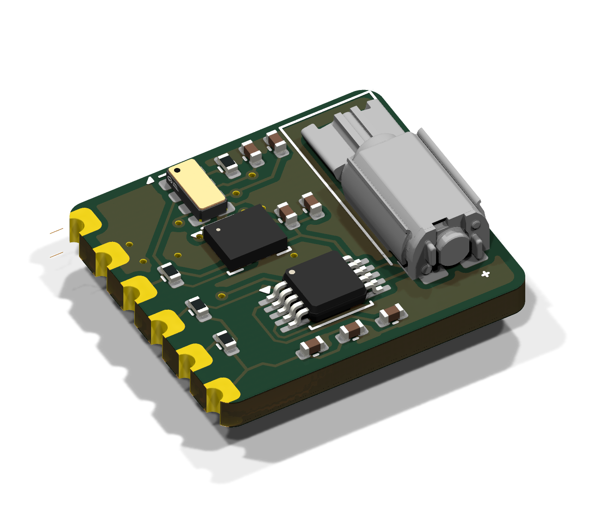
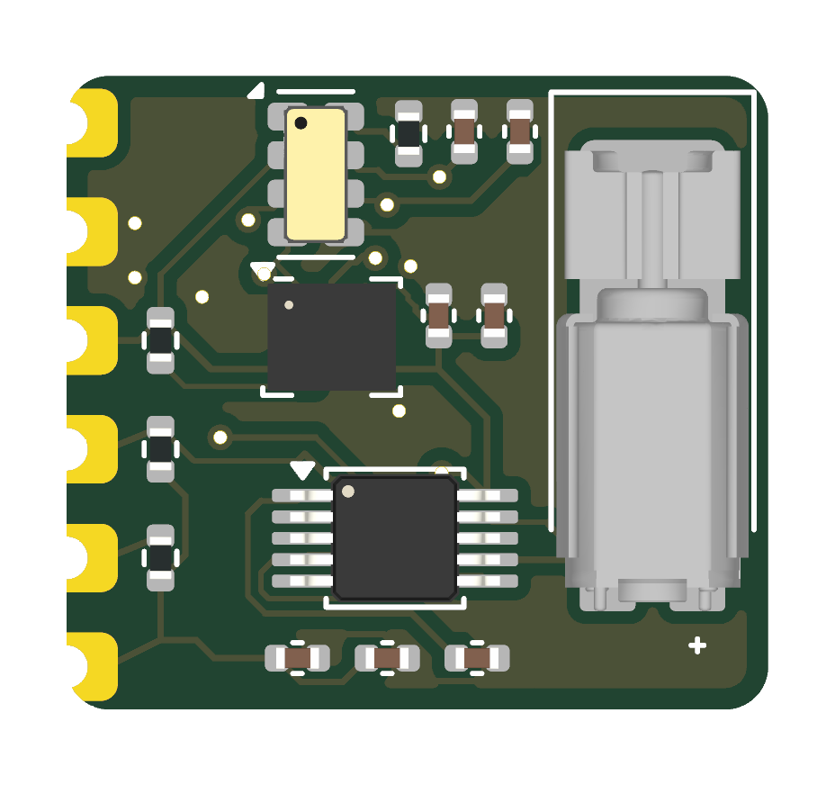
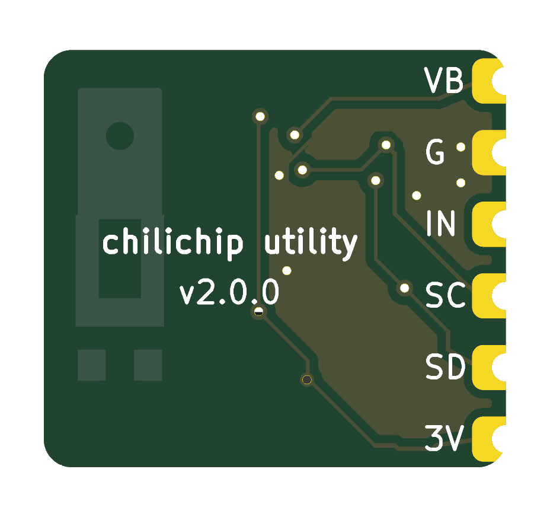
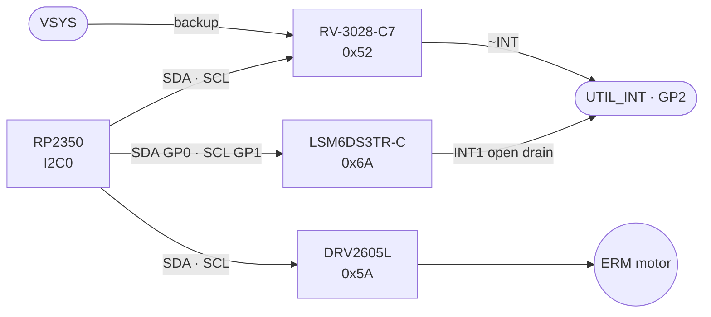
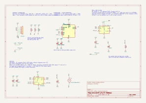

# Utility module

The utility module adds a motion sensor, a real-time clock and a vibration motor. All three chips sit on one I²C bus, so the module needs only three GPIOs. It solders flat onto the back of the console, next to the RP2350-Plus.

Repository: [chili-chip/chili-utility-module-hardware](https://github.com/chili-chip/chili-utility-module-hardware) · Latest release: [v2.0.0](https://github.com/chili-chip/chili-utility-module-hardware/releases/tag/v2.0.0)

{ loading=lazy }

<figure markdown>
{ loading=lazy }
<figcaption>Top</figcaption>
</figure>
<figure markdown>
{ loading=lazy }
<figcaption>Bottom: pin labels, faces the main board</figcaption>
</figure>

## Specifications

| | |
|---|---|
| Motion sensor | ST LSM6DS3TR-C, 3-axis accelerometer and 3-axis gyroscope |
| Clock | Micro Crystal RV-3028-C7, crystal built in, ±1 ppm, 45 nA |
| Haptics | TI DRV2605L driver with 123 built-in effects |
| Motor | Vybronics VZ43FC1B5640007L, SMD ERM, 4.3 × 4.5 × 12 mm, 3 V, about 77 mA |
| Bus | I²C, 4.7 kΩ pull-ups on the module |
| Interrupt | One open-drain line shared by the IMU and the RTC, 10 kΩ pull-up |
| Supply | 3.3 V; RTC backup from the console's VSYS |
| Board | 16.4 × 14.8 mm, 2 layers, 1.6 mm, parts on top, 4.3 mm tall at the motor |
| Host connection | 6 castellated half-holes, 2.54 mm pitch |

## Pinout

| Pin | Signal | Console | Notes |
|---|---|---|---|
| J1.1 | 3V3 | RP2350-Plus 3V3 | |
| J1.2 | SDA | GP0 (I2C0 SDA) | 4.7 kΩ pull-up R1 |
| J1.3 | SCL | GP1 (I2C0 SCL) | 4.7 kΩ pull-up R2 |
| J1.4 | INT | GP2 | Open drain, IMU INT1 and RTC ~INT, 10 kΩ pull-up R3 |
| J1.5 | GND | GND | |
| J1.6 | VBAT | VSYS (RP2350-Plus pin 39) | RTC backup, 3.4 to 4.95 V, always on while the LiPo is fitted |

The silkscreen labels on the bottom read VB, G, IN, SC, SD and 3V.

## I²C devices

| Address | Chip | What it does |
|---|---|---|
| 0x6A | LSM6DS3TR-C | Tilt, motion, step counting, tap and free-fall detection |
| 0x52 | RV-3028-C7 | Date and time, alarms, keeps time while the console is off |
| 0x5A | DRV2605L | Plays vibration effects on the motor |

## Firmware setup

The hardware relies on these settings.

| Chip | Setting | Why |
|---|---|---|
| IMU | `CTRL3_C` bit `PP_OD = 1` (open drain) before enabling any interrupt | INT1 shares the line with the RTC |
| RTC | Backup switchover in level-switching mode: `BSM = 11` in register 37h, stored to EEPROM | Switchover is off when the chip ships |
| RTC | Leave the trickle charger off (`TCE = 0`, the default) | The backup comes from VSYS and must never be charged from VDD |
| RTC | Turn CLKOUT off | It outputs 32.768 kHz by default and wastes current |
| Haptic driver | ERM mode, ERM effect library, auto-calibration once (rated 3.0 V, 2.5 to 3.4 V) | Matches the motor |
| Haptic driver | Standby through the `MODE` register when idle | EN is tied high on the module |

The motor leads are swapped (OUT+ to its − pad) to keep the traces apart. An ERM motor vibrates the same either way.

## Bill of materials

| Ref | Function | Part | LCSC |
|---|---|---|---|
| U1 | Gyro and accelerometer | ST LSM6DS3TR-C, LGA-14 2.5 × 3 mm | [C967633](https://www.lcsc.com/product-detail/C967633.html) |
| U2 | Real-time clock | Micro Crystal RV-3028-C7, SON-8 1.5 × 3.2 mm | [C3019759](https://www.lcsc.com/product-detail/C3019759.html) |
| U3 | Haptic driver | TI DRV2605L, VSSOP-10 | [C527464](https://www.lcsc.com/product-detail/C527464.html) |
| M1 | Vibration motor | Vybronics VZ43FC1B5640007L | Not on LCSC: [Digi-Key 12323649](https://www.digikey.com/en/products/detail/vybronics-inc/VZ43FC1B5640007L/12323649) |
| C1 to C4, C6 | Decoupling | 100 nF 0402, Samsung CL05B104KO5NNNC | C1525 |
| C5, C7 | Driver VDD and REG | 1 µF 0402, Samsung CL05A105KA5NQNC | C52923 |
| R1, R2 | I²C pull-ups | 4.7 kΩ 0402 | C25900 |
| R3, R4 | INT pull-up, EVI tie-down | 10 kΩ 0402 | C25744 |

### Why these parts

| Part | Reason | Alternatives looked at |
|---|---|---|
| LSM6DS3TR-C | Active ST part with mature drivers | QST QMI8658A: fewer drivers, no KiCad symbol |
| RV-3028-C7 | No external crystal, ±1 ppm, automatic backup switchover rated 1.1 to 5.5 V | NXP PCF85063A: needs a crystal, about 5× the current |
| DRV2605L | Haptic effects over I²C, so no PWM pin is needed (the console has none left) | MOSFET and diode: needs a spare PWM GPIO |
| VSYS backup | No coin cell holder; the LiPo keeps the RTC running for years at about 115 nA | CR1220 coin cell (v1.0.0): needs a 20 × 13 mm holder |

Lower-cost options for the motor and the RTC are tracked in [chili-utility-module-hardware #2](https://github.com/chili-chip/chili-utility-module-hardware/issues/2).

## Schematic

[{ .drawing loading=lazy }](../schematics/utility-module.svg)

## Ordering

Each release has `chili-utility-module-<version>-gerbers.zip`, `-bom.csv` and `-cpl.csv` attached.

1. Upload the gerber zip on [jlcpcb.com](https://jlcpcb.com/). Set 2 layers, 1.6 mm, **Castellated Holes: Yes**.
2. Turn on **PCB Assembly**, top side, and upload the BOM and CPL.
3. In the placement preview, check pin 1 of U1 to U3, and that the motor's terminals are at the bottom, next to U3.
4. The motor M1 has no LCSC number. Use JLCPCB global sourcing or consign it.
5. Do not wash the board after assembly. The motor must not get flux washes or conformal coating.

## Open points

| Point | Status |
|---|---|
| IMU SDx/SCx tie-off | Tied to GND. To check against ST's datasheet pin table |
| Power budget | The motor draws about 77 mA (100 mA max) from the RP2350-Plus 3.3 V output while it runs |
| Motor sourcing | Not stocked by LCSC |

## Versions

| Version | Date | What changed |
|---|---|---|
| [v1.0.0](https://github.com/chili-chip/chili-utility-module-hardware/releases/tag/v1.0.0) | 5 Nov 2026 | 30 × 32 mm, CR1220 coin cell, 10 mm coin motor on wire leads |
| [v2.0.0](https://github.com/chili-chip/chili-utility-module-hardware/releases/tag/v2.0.0) | 6 Nov 2026 | 16.4 × 14.8 mm, RTC backup from VSYS on a sixth pad, SMD motor |

Main board v3.0.0 needs v2.0 or later.
