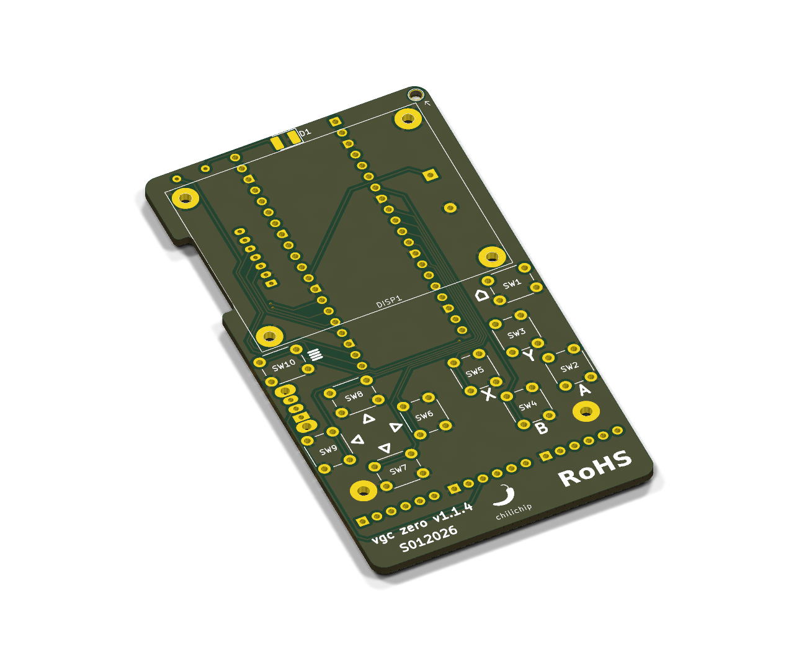
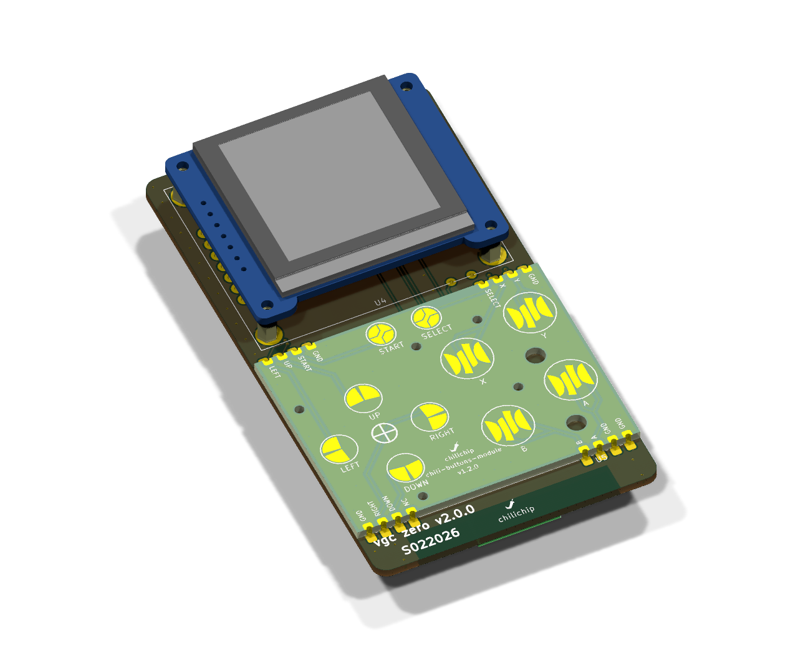

# Revisions and roadmap

Every main board revision is a tag and a GitHub release in [vgc-zero-hardware](https://github.com/chili-chip/vgc-zero-hardware/releases). The releases carry the schematic PDF, a PCB image and the Gerbers.

## Main board history

| Version | Released | Board | Processor | Big changes |
|---|---|---|---|---|
| Breadboard | 2025 | Breadboard | Pico board | First prototype with a 1.44" ST7735S TFT. See the [breadboard guide](https://chilichip.eu/docs/vgc-zero/vgc-breadboard/) |
| v0.0.1 to v1.0.2 | 11 Dec 2025 | First PCBs | Raspberry Pi Pico 2 | First KiCad board: TP4056 charger module, LiPo, speaker, through-hole buttons, power switch |
| v1.1.0 to v1.1.4 | 2 to 7 Mar 2026 | 50 × 90 mm | Waveshare RP2350-Plus | Through-hole buttons, buzzer, LED, power switch, display on a JST cable. Fabricated and playable |
| [v2.0.0](https://github.com/chili-chip/vgc-zero-hardware/releases/tag/v2.0.0) | 5 Nov 2026 | 50 × 90 mm | Raspberry Pi Pico 2 | Castellated modules: buttons, audio, radio. Display on a pin header. USB power only |
| [v3.0.0](https://github.com/chili-chip/vgc-zero-hardware/releases/tag/v3.0.0) | 6 Nov 2026 | 50 × 100 mm | Waveshare RP2350-Plus | Flush LiPo, utility module (IMU, RTC, haptics), all 26 GPIOs used |

### v1.1.4

The board that the console firmware targets today.

{ loading=lazy width="560" }

| | |
|---|---|
| Processor | Waveshare RP2350-Plus |
| Buttons | 10 through-hole tactile switches (D-pad, A, B, X, Y, MENU, HOME) |
| Sound | Buzzer driven by PWM on GP22 |
| Display | Waveshare 1.5" OLED on a 7-pin JST cable |
| Power | LiPo on the RP2350-Plus, hard power switch |
| Extras | Status LED |

Known issues on v1.1.4 led to [#10](https://github.com/chili-chip/vgc-zero-hardware/issues/10) to [#13](https://github.com/chili-chip/vgc-zero-hardware/issues/13) (bigger holes, single pin header, longer resistor, display connector pin order) and to the sound and display changes in [#20](https://github.com/chili-chip/vgc-zero-hardware/issues/20) and [#21](https://github.com/chili-chip/vgc-zero-hardware/issues/21).

### v2.0.0

The first board built from modules.

{ loading=lazy width="560" }

| | |
|---|---|
| Processor | Raspberry Pi Pico 2, soldered flat |
| Buttons | Buttons module v1.2, castellated |
| Sound | Audio module (MAX98357A) |
| Radio | Raspberry Pi Radio Module 2 |
| Power | USB only, no battery |

The plan it implemented is in [`docs/next-revision.md`](https://github.com/chili-chip/vgc-zero-hardware/blob/master/docs/next-revision.md).

### v3.0.0

The current board. Everything on this site describes it.

| Change from v2.0.0 | Why |
|---|---|
| Pico 2 → RP2350-Plus | LiPo charger and 16 MB flash on the module |
| 50 × 90 → 50 × 100 mm | Room for the battery flat on the back |
| LP802540 LiPo, flush on the back | Battery power without a thicker console |
| Utility module added | Tilt, real-time clock and rumble on three GPIOs |

## Firmware support per board

| Board | Console firmware |
|---|---|
| v1.1.4 | Supported (`chilichip_vgc`) |
| v2.0.0 | Not supported, no battery; superseded by v3.0.0 |
| v3.0.0 | Needs new board files. See [firmware and software](console/firmware.md#pin-map-differences) |

## Work in progress

!!! note "Not released"
    The designs below are not released. They can change at any time. Do not order them for a console yet.

| Design | Repository | Status |
|---|---|---|
| Single fully assembled board: RP2350 on the main board, all modules merged, bare SSD1351 panel | [chilichip-console-hardware](https://github.com/chili-chip/chilichip-console-hardware) | Planning. Starts from Raspberry Pi's RP2350A minimal design. Deferred until after launch ([32blit-sdk #63](https://github.com/chili-chip/32blit-sdk/issues/63)). Display plan in [#16](https://github.com/chili-chip/chilichip-console-hardware/issues/16) |
| Custom silicone keypad | [vgc-zero-hardware #33](https://github.com/chili-chip/vgc-zero-hardware/issues/33) | Prototyping with GBA pads |
| Shell | [vgc-zero-shell](https://github.com/chili-chip/vgc-zero-shell) | Shell 0v1 (3MF), made for the older boards |

## Earlier and side projects

These designs are not part of the current console. They are listed so nobody has to guess what they are.

| Design | Repository | What it is |
|---|---|---|
| VGC-0 on RP2350 and ESP8684 | [vgc-pico-hw](https://github.com/chili-chip/vgc-pico-hw) | September 2025 KiCad design: RP2350 chip on the board, ESP8684 for Wi-Fi and extra GPIO, 6 buttons, 2 system buttons and an encoder wheel. Not continued |
| Luckfox Pico variant | [vgc-zero-luckfox-pico](https://github.com/chili-chip/vgc-zero-luckfox-pico) | Linux SDK fork for an older Luckfox Pico based idea. Inactive since 2025 |

## Open hardware issues

The board's open issues are in [vgc-zero-hardware issues](https://github.com/chili-chip/vgc-zero-hardware/issues).

| Issue | Topic |
|---|---|
| [#32](https://github.com/chili-chip/vgc-zero-hardware/issues/32) | Console modules: tracking issue |
| [#31](https://github.com/chili-chip/vgc-zero-hardware/issues/31), [#33](https://github.com/chili-chip/vgc-zero-hardware/issues/33) | Buttons module and rubber dome feel |
| [#20](https://github.com/chili-chip/vgc-zero-hardware/issues/20), [#23](https://github.com/chili-chip/vgc-zero-hardware/issues/23), [#24](https://github.com/chili-chip/vgc-zero-hardware/issues/24) | Audio |
| [#21](https://github.com/chili-chip/vgc-zero-hardware/issues/21) | Display on a pin header |
| [#25](https://github.com/chili-chip/vgc-zero-hardware/issues/25) | Wi-Fi and Bluetooth |
| [#19](https://github.com/chili-chip/vgc-zero-hardware/issues/19) | Gyroscope and vibrator |
| [#4](https://github.com/chili-chip/vgc-zero-hardware/issues/4), [#5](https://github.com/chili-chip/vgc-zero-hardware/issues/5) | Debug and UART sockets |
| [#1](https://github.com/chili-chip/vgc-zero-hardware/issues/1) | Enter boot mode with the buttons |
